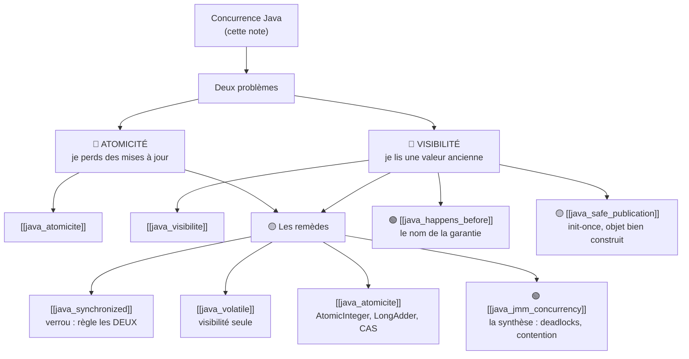

# Concurrence Java : ce qui te concerne vraiment

> [!abstract] Ancre
> Cette note répond à **une seule question** : *« mon application Spring Boot est stateless — est-ce que tout ce bazar de concurrence me concerne ? »*
>
> **Réponse courte : oui, mais pas là où tu crois.** Elle explique **pourquoi tu ne tombes presque jamais dedans**, **où tu y tombes quand même**, et **à quel niveau tu dois maîtriser chaque notion**.

---

## 🧒 Avant de commencer : la question qui déclenche tout

> [!tip] En clair
> Tu écris des `@Service` sans champ mutable. Tes requêtes sont indépendantes. Tu déploies en 4 instances derrière un load balancer. **Tu n'as jamais eu de bug de concurrence.**
>
> **Et tu as raison de ne pas en avoir** — ce n'est pas de la chance, c'est **une décision d'architecture qui marche**.
>
> 🔑 **Alors pourquoi cette note existe-t-elle ?**
>
> Parce que « stateless » décrit **ce que TU écris** — pas **ce qui s'exécute**. Dès que tu utilises un **cache**, un **compteur de métrique**, un **pool de connexions**, ou une **initialisation unique**, tu **utilises** de l'état partagé — écrit par d'autres, pour toi.
>
> **Le sujet de cette note n'est pas « comment écrire du concurrent ». C'est : « comment savoir si ce que j'utilise est sûr ».**

---

## 1. Pourquoi ce sujet existe

> [!tip] En clair
> Un serveur web (Tomcat, Netty, Undertow) traite les requêtes **en parallèle**, sur **plusieurs threads**. C'est tout.
>
> **Ton `@Service` est un objet UNIQUE** — Spring en crée **une seule instance** (`singleton` par défaut) — **partagée** par **tous** les threads de requête.
>
> Ce n'est pas un détail : c'est **la source de tout**.

```
                    ┌─────────────────────────────────┐
    Requête 1 ─────►│                                 │
    Requête 2 ─────►│   MonService  (UNE SEULE          │◄── le MÊME objet
    Requête 3 ─────►│   instance, partagée)            │    pour tous les threads
    Requête 4 ─────►│                                 │
                    └─────────────────────────────────┘
```

> ⚠️ **Le point à saisir :** une instance unique, appelée par plusieurs threads **en même temps**. Si cette instance a **un champ qui change**, tu as un état partagé. Sinon, tu n'as **rien** à craindre.

---

## 2. Pourquoi tu ne le vois JAMAIS en Spring Boot

> [!tip] En clair
> **C'est ici que ton architecture te sauve** — et ce n'est pas un hasard. Voici les **quatre raisons**, et elles sont **cumulatives**.

| Ce que tu fais | Ce que ça élimine |
|---|---|
| **Services sans champ mutable** | pas d'état partagé → **pas de data race possible** |
| **Variables locales par requête** | chaque appel a **sa propre** donnée → elle vit et meurt avec l'appel |
| **Repositories / bases de données** | l'état vit **dans la base**, pas en mémoire → la concurrence se déplace au niveau SQL |
| **Injection de dépendances** | les collaborateurs sont **sans état** par convention → tout le graphe est sûr |

```java
@Service
public class FactureService {                 // ✅ singleton, MAIS sans état

    private final FactureRepository repo;     // ✅ final : ne change jamais
    private final PdfGenerator pdf;           // ✅ final : sans état

    public FactureService(FactureRepository repo, PdfGenerator pdf) {
        this.repo = repo;
        this.pdf = pdf;
    }

    public Facture creer(DemandeFacture demande) {
        Facture facture = new Facture(demande);   // ← VARIABLE LOCALE
        repo.save(facture);                       // ← l'état va en base
        return facture;
    }
}
```

> 🔑 **Pourquoi ce code est totalement sûr, même appelé par 200 threads :**
> - `repo` et `pdf` sont **`final`** → ils ne changent **jamais** après construction.
> - `facture` est une **variable locale** → elle appartient **au thread** qui l'exécute.
> - **Aucun champ partagé qui soit modifié.** Rien à protéger.

> [!tip] Le réflexe qui te suffit au quotidien
> **« Est-ce que j'ai un champ non-`final` dans ce bean ? »**
> - **Non** → tu peux arrêter de lire cette note. Ton code est sûr.
> - **Oui** → alors lis la suite. ⬇️

---

## 3. Les limites de cette approche ⭐ *(le cœur de la note)*

> [!warning] Voilà le vrai sujet — et celui qui te concerne
> Tu ne **codes** pas d'état partagé. Mais tu **utilises** des objets qui en ont, **sans le voir**. Et c'est **exactement** là que la théorie devient utile.

### Les trois niveaux d'état

| Niveau | Qui l'écrit | Tu y tombes ? |
|---|---|---|
| **① L'état de requête** — un champ de `@Service` qui change à chaque appel | **toi** | ❌ Non — tu fais bien les choses |
| **② L'état partagé par conception** — cache, compteur, pool | **toi ou une lib, volontairement** | ⚠️ **OUI** — tous les jours |
| **③ L'état de l'infrastructure** — ce que **Spring lui-même** manipule | **le framework** | ⚠️ **OUI**, sans le voir |

> 🔑 **La phrase à retenir :**
> **« Stateless côté code ≠ stateless côté exécution. »**
> Tu **délègues** l'état à des objets conçus par d'autres. La théorie ne sert pas à **écrire** du concurrent — elle sert à **savoir si ce que tu utilises est sûr**.

### Les 6 cas où tu tombes dedans **sans écrire une ligne de stateful**

| # | Ce que tu utilises | L'état caché | Le niveau de maîtrise nécessaire |
|---|---|---|---|
| **1** | **`@Cacheable`, Caffeine, Redis** | une **map partagée** entre tous les threads | 🟡 **savoir** que le cache doit être *thread-safe* (les libs le sont) |
| **2** | **Compteurs / métriques** (Micrometer, `MeterRegistry`) | des **compteurs incrémentés** par des milliers de threads | 🟢 **reconnaître** — la lib gère, tu ne touches pas |
| **3** | **Pools de connexions** (HikariCP) | une **ressource rare**, partagée et protégée | 🟡 **savoir** que `maximumPoolSize` est un choix de dimensionnement |
| **4** | **`@Async`, `@Scheduled`, `CompletableFuture`** | du code exécuté **sur d'autres threads** | 🔴 **comprendre** — c'est ici qu'on se brûle vraiment |
| **5** | **Initialisation unique** (`@PostConstruct`, singleton *lazy*, init paresseuse) | « initialiser **une seule fois**, pour tous » | 🔴 **comprendre** — c'est le `happens-before` en action |
| **6** | **`ThreadLocal`** (`RequestContextHolder`, `SecurityContextHolder`) | une valeur **attachée au thread**, pas à la requête | 🟡 **savoir** — et savoir qu'il faut **nettoyer** |

> [!warning] Le cas n°4 est celui qui fait mal
> ```java
> @Async
> public void traiterAsync(Commande c) {
>     // ← ce code tourne sur un AUTRE thread
>     // ← si tu touches un champ partagé ici, tu es en plein dans le sujet
> }
> ```
> Dès que tu mets **`@Async`**, tu quittes le monde « stateless » : ton code s'exécute **sur un autre thread**, **en parallèle** de la requête qui l'a lancé. **C'est là qu'un dev Spring se brûle.**

> [!tip] Le cas n°5, en une image
> 🔑 **« Initialiser une seule fois »** — c'est le pattern le plus courant et le plus piégeux :
> ```java
> private Config config;                       // ❌ pas final, pas volatile
>
> @PostConstruct
> public void init() { config = charger(); }   // ← un thread
>
> public Config getConfig() { return config; } // ← un AUTRE thread peut voir null !
> ```
> Ce n'est **pas** un `@PostConstruct` qui est en cause : c'est que **rien ne garantit** que l'écriture du premier thread soit **visible** pour les autres. Le remède : un champ **`final`** (initialisé dans le constructeur) — ou `volatile` si tu dois le remplir après. **C'est exactement ça, `happens-before` en production.**

---

## 4. Les trois niveaux de maîtrise ⭐ *(le principe de lecture)*

> [!tip] En clair
> Toute cette famille de notes étiquette chaque notion selon **ce que tu dois en faire**. Ce ne sont **pas** les mêmes niveaux, et **il est normal de ne pas tout maîtriser**.

| Niveau | Ce que tu dois pouvoir faire | Tu peux l'oublier après ? |
|---|---|---|
| 🔴 **COMPRENDRE** | **expliquer pourquoi ça existe**, et reconnaître le problème | ❌ non — c'est le socle |
| 🟡 **SAVOIR UTILISER** | **l'appliquer** correctement dans ton code | ❌ non — tu en as besoin au quotidien |
| 🟢 **RECONNAÎTRE** | savoir que ça existe, ne pas se tromper en le croisant | ✅ **oui** — c'est le but |

**Concrètement, sur les notions de cette famille :**

| Notion | Niveau | Pourquoi |
|---|---|---|
| **thread, stateful / stateless** | 🔴 **comprendre** | c'est le socle de tout le reste |
| **visibilité** | 🔴 **comprendre** | « pourquoi je lis une valeur périmée » — tu dois savoir le diagnostiquer |
| **atomicité** | 🔴 **comprendre** | « pourquoi je perds une mise à jour » |
| **`happens-before`** | 🟢 **reconnaître** | connaître le **nom** suffit ; tu n'écriras pas de preuve formelle |
| **`volatile`** | 🟡 **savoir utiliser** | sur un flag d'état, tu dois savoir quand le mettre |
| **`synchronized`** | 🟡 **savoir utiliser** | protéger une section critique simple |
| **`AtomicInteger` / `LongAdder`** | 🟡 **savoir utiliser** | pour un compteur — mais souvent la lib le fait déjà |
| **CAS** | 🟢 **reconnaître** | savoir ce que c'est quand tu le croises |
| **deadlock, contention** | 🟢 **reconnaître** | savoir **diagnostiquer** si ça arrive, pas les prévenir par design |
| **structures concurrentes** | 🟡 **savoir utiliser** | `ConcurrentHashMap` plutôt qu'une `HashMap` partagée |

> 🔑 **Tu n'as PAS besoin de maîtriser** l'écriture d'une structure de synchronisation complexe. **Personne** ne s'amuse à ça. Tu as besoin de **savoir qu'elle existe** et de **reconnaître** quand tu marches dessus. **C'est une très bonne nouvelle.**

---

## 5. Ne pas confondre les trois concurrences

> [!tip] En clair
> C'est une source de confusion fréquente : dans une appli Spring Boot, il y a **trois** problèmes concurrents **différents**. Ils sont **liés**, mais ce ne sont **pas les mêmes** — et ils ne se résolvent **pas** avec les mêmes outils.

| | **① Threads Java** | **② Transactions SQL** | **③ Instances multiples** |
|---|---|---|---|
| **Où** | en **mémoire**, dans une JVM | dans la **base**, entre transactions | entre **plusieurs pods / serveurs** |
| **Le risque** | data race, valeur périmée | *lost update*, lecture sale | deux instances se contredisent |
| **L'outil** | `volatile`, `synchronized`, `Atomic*` | isolation, verrous SQL, `@Transactional` | verrou distribué, leader election, BD |
| **Ta note** | ⬅️ **celle-ci** | *(hors périmètre — à faire)* | *(hors périmètre — à faire)* |

> [!warning] Le piège du mauvais outil
> `synchronized` ne protège **rien** entre **deux instances** de ton service. Et une transaction SQL ne protège **rien** contre une data race en mémoire. **Ce sont trois problèmes séparés.**
>
> 🔑 **Le réflexe :** devant un problème de concurrence, demander d'abord **« à quel niveau je suis ? »** — mémoire, base, ou instances.

---

## 6. Les garanties Java (dans l'ordre : problème d'abord)

> [!tip] En clair
> Maintenant que tu sais **pourquoi** ça compte (section 3) et **à quel niveau** tu dois maîtriser (section 4), voici **les deux problèmes** que Java te laisse gérer.

### Les deux problèmes — à ne jamais confondre

| | **ATOMICITÉ** | **VISIBILITÉ** |
|---|---|---|
| **La question** | « mes opérations peuvent-elles **s'entremêler** ? » | « est-ce que je **vois** ce que l'autre vient d'écrire ? » |
| **Le symptôme** | je **perds** des mises à jour | je reste bloqué sur une **valeur ancienne** |
| **Le scénario typique** | deux débits sur le même compte → 100 € disparus | un `@PostConstruct` qui n'initialise « pas » le champ pour les autres threads |
| **Sa note** | [[java_atomicite]] | [[java_visibilite]] |

> ⚠️ **Pourquoi les séparer absolument :** on croit qu'**un seul remède** règle les deux. **C'est faux.**
>
> | Outil | Atomicité ? | Visibilité ? |
> |---|---|---|
> | `volatile` | ❌ **non** | ✅ oui |
> | `AtomicInteger` | ✅ oui | ✅ oui |
> | `synchronized` | ✅ oui | ✅ oui |

### Le contrat de Java, en une phrase

> **Deux threads qui accèdent à la même donnée SANS coordination ne bénéficient d'AUCUNE garantie.**
>
> Ni sur **quand** ils voient les écritures de l'autre. Ni sur **l'ordre** des opérations.

> [!warning] Trois pièges de lecture (à ne pas croire)
> **❌ « Chaque thread garde une copie privée de chaque variable. »** → c'est une **image** pour intuiter, pas une description. La formulation juste : **« pas de garantie sans coordination »**.
>
> **❌ « Un thread peut voir une valeur qui n'a jamais existé. »** → **trop fort**. Le modèle Java impose des règles précises. Ce qu'on observe : une **valeur ancienne**, une **écriture perdue**, un **effet de réordonnancement**.
>
> **❌ « Variables locales dans la stack, champs dans la heap — toujours. »** → c'est un **modèle pour raisonner**, pas une garantie d'implémentation. La JVM peut optimiser le stockage.

### Le mot que tu verras partout : `happens-before`

> 🟢 **Niveau « reconnaître ».** Tu n'as besoin que de retenir ceci :
>
> *« `happens-before` est le nom technique de la garantie. Créer cette garantie, c'est ce que font `volatile`, `synchronized`, ou le démarrage d'un thread. »*
>
> 👉 Le détail est dans [[java_happens_before]] — **tu n'en as pas besoin** pour lire cette note.

---

## 7. Où aller ensuite

> [!tip] En clair
> Voici la carte. **Chaque note est étiquetée par son niveau** — commence par les 🔴, puis les 🟡, et survole les 🟢.



| Note | Niveau | Ce qu'elle répond |
|---|---|---|
| [[java_visibilite]] | 🔴 comprendre | « pourquoi je lis une valeur ancienne ? » |
| [[java_atomicite]] | 🔴 comprendre | « pourquoi je perds des mises à jour ? » |
| [[java_volatile]] | 🟡 utiliser | « quand `volatile` suffit-il, et quand non ? » |
| [[java_synchronized]] | 🟡 utiliser | « comment protéger une section de code ? » |
| [[java_safe_publication]] | 🟡 utiliser | « comment publier un objet sans qu'on le voie à moitié construit ? » |
| [[java_happens_before]] | 🟢 reconnaître | « c'est quoi cette garantie, exactement ? » |
| [[java_jmm_concurrency]] | 🟢 reconnaître | la synthèse : CAS, deadlocks, contention, collections concurrentes |

---

## Pièges fréquents

> [!tip] En clair
> **Les 5 erreurs — celles qui te concernent vraiment :**
> 1. **Croire que « stateless » couvre tout** → il couvre **ton** code, pas le cache / le pool / `@Async`.
> 2. **Toucher à un champ partagé depuis un `@Async`** → tu es sorti du monde stateless sans t'en rendre compte.
> 3. **Un `@PostConstruct` qui écrit dans un champ non-`final`** → les autres threads peuvent voir `null`.
> 4. **Confondre les 3 concurrences** → `synchronized` ne protège **rien** entre deux instances.
> 5. **Ajouter un `synchronized` « au cas où »** → contention inutile, sur un code qui n'avait **pas** de problème.

- **« Mon appli est stateless, donc rien à faire »** — vrai pour ton code, faux pour ce que tu **utilises** (cache, pool, métriques, `@Async`). Réflexe : se demander *« cet objet a-t-il un champ mutable partagé ? »* — pas *« est-ce que j'ai des threads ? »*.
- **Le `@Async` oublié** — le code s'exécute sur un **autre thread**, en parallèle. Réflexe : tout ce qu'un `@Async` touche doit être **thread-safe**, ou **local**.
- **L'initialisation paresseuse non publiée** — un champ rempli après le constructeur, lu par un autre thread sans garantie. Réflexe : **`final`** quand c'est possible, sinon `volatile` ou une initialisation dans le constructeur.
- **Le cache maison non borné** — une `HashMap` en champ de bean, remplie à chaque requête : data race **et** fuite mémoire. Réflexe : utiliser **Caffeine** (ou `ConcurrentHashMap` avec `computeIfAbsent`) — et une **borne**.
- **La confusion des niveaux** — vouloir régler un problème entre instances avec `synchronized`, ou un problème mémoire avec `@Transactional`. Réflexe : identifier **le niveau** avant de choisir l'outil.
- **Sur-synchroniser** — des `synchronized` partout sur un code qui n'a aucun état partagé : tu ajoutes de la **contention** et tu ne corriges **rien**. Réflexe : identifier **l'invariant** à protéger d'abord.
- **Tester la concurrence avec un test unitaire** — un bug de concurrence dépend de la **charge** et du **nombre de cœurs**. Réflexe : raisonner en **garanties**, pas en observations.

---

## Rappel

> [!question] Question de rappel
> Ton `FactureService` a un champ `private final PdfGenerator pdf` et un champ `private Map<String, Facture> cache = new HashMap<>();` rempli dans la méthode `creer()`. **Ce bean est-il thread-safe ?** Que faudrait-il changer ?

> [!success]- Réponse
> **Non, il n'est pas thread-safe — à cause du second champ.** `pdf` est `final` et sans état : parfaitement sûr, même appelé par 200 threads. Mais `cache` est une **`HashMap` non synchronisée**, **partagée** entre tous les threads de requête (rappel : un `@Service` Spring est un **singleton**). Deux threads peuvent l'écrire **en même temps** → corruption de la structure interne, entrées perdues, voire boucle infinie selon la version de la JVM. C'est un problème de **niveau ② : état partagé par conception** — tu ne l'as pas fait *exprès*, mais tu l'as bien **écrit**. **Les corrections :** ① utiliser une structure **concurrente** (`ConcurrentHashMap` avec `computeIfAbsent`) ; ② **borner** le cache (Caffeine, avec une taille maximale et une expiration) — sinon tu ajoutes une **fuite mémoire** au problème de concurrence ; ③ ou, mieux, **déléguer à un vrai cache** (`@Cacheable` + Caffeine/Redis), qui est déjà *thread-safe* et testé. **Le réflexe :** *« est-ce que j'ai un champ non-`final` dans ce bean ? »* — ici, la réponse est **oui**, et c'est là qu'est le bug.

### 🎯 Le résumé à retenir

> [!tip] Si tu ne retiens qu'une chose
> **Ton code stateless est sûr. Ce que tu *utilises* ne l'est pas forcément.**
>
> - **Un `@Service` est un singleton** partagé par tous les threads → **un champ non-`final` = un état partagé**.
> - **Tu ne tombes presque jamais dedans** — grâce à ton architecture. **C'est un bon choix, pas de la chance.**
> - **Tu y tombes quand même** via : **cache**, **compteur**, **pool**, **`@Async`**, **init-once**.
> - **Trois niveaux de maîtrise** : 🔴 comprendre · 🟡 savoir utiliser · 🟢 reconnaître. **Tu n'as pas besoin de tout maîtriser.**
> - **Trois concurrences distinctes** : mémoire (cette note) · SQL · instances. **Ne pas les confondre.**
> - **Le réflexe de tous les jours :** *« ce bean a-t-il un champ non-`final` ? »* — non → tu peux fermer. oui → tu es dans le sujet.

---

## 🗣️ Les questions qu'on te posera

> [!tip] En clair
> Les questions classiques sur le sujet, et la réponse courte qui résume l'essentiel.

| Si on te demande… | Réponds… |
|---|---|
| **« Un `@Service` Spring, c'est thread-safe ? »** | « Le **singleton** n'est pas thread-safe **par nature** — il l'est **si** il n'a **aucun champ mutable**. Sinon, ses champs sont partagés par tous les threads. » |
| **« Ton appli est stateless, tu as des problèmes de concurrence ? »** | « **Rarement dans mon code, oui dans ce que j'utilise** : caches, compteurs de métriques, pools de connexions, `@Async`, initialisation unique. » |
| **« C'est quoi le premier réflexe ? »** | « *« Ce bean a-t-il un champ non-`final` ? »* — c'est **le seul test** qui compte en pratique. » |
| **« `volatile` ou `synchronized` ? »** | « `volatile` = visibilité seule (fluk d'état). `synchronized` = atomicité **et** visibilité. Le second est plus lourd. » |
| **« `synchronized` protège mes données entre 2 instances ? »** | « **Non** : il ne protège qu'**à l'intérieur d'une JVM**. Entre instances, il faut un **verrou distribué** ou la **base**. » |
| **« `@PostConstruct` qui remplit un champ, ça suffit ? »** | « **Non** : rien ne garantit que l'écriture soit **visible** aux autres threads. Préférer un champ **`final`** ou `volatile`. » |
| **« Dois-je maîtriser les deadlocks et le CAS ? »** | « **Reconnaître** suffit : savoir ce que c'est quand on les croise. En écrire n'est **pas** nécessaire au quotidien. » |

> [!tip] La phrase qui tue
> **« Mon code est stateless, donc sûr — mais ce que j'utilise ne l'est pas forcément : un `@Service` est un singleton, et un seul champ non-`final` suffit à me mettre dans le sujet. »**

---

## Voir aussi

- [[java_visibilite]] — 🔴 le problème n°1 : je lis une valeur ancienne.
- [[java_atomicite]] — 🔴 le problème n°2 : je perds des mises à jour.
- [[java_volatile]] — 🟡 la visibilité seule, sans verrou.
- [[java_synchronized]] — 🟡 le verrou : règle les deux problèmes.
- [[java_safe_publication]] — 🟡 init-once, et partager un objet correctement.
- [[java_happens_before]] — 🟢 le nom de la garantie, et ses règles.
- [[java_jmm_concurrency]] — 🟢 la synthèse : CAS, deadlocks, contention.
- [[java_threads_executors]] — qui exécute tout ça : pools et virtual threads.
- [[index]] — carte d'entrée du domaine Java.

## Références

- JLS — *Java Language Specification*, **§17 Threads and Locks** : la spécification normative du modèle mémoire.
- JSR-133 — *Java Memory Model and Thread Specification* (la refonte de Java 5).
- Brian Goetz et al. — *Java Concurrency in Practice*, chapitre 3 « Sharing Objects ».
- Spring Framework — *Bean scopes* : le scope `singleton` (défaut) et ses implications de concurrence.
