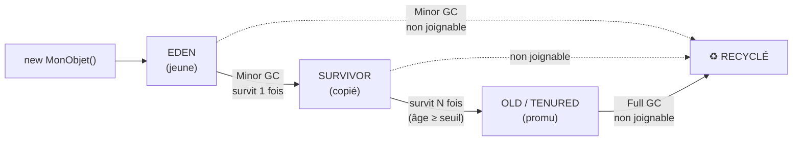

# Garbage Collection : générations, collecteurs et fuites

> [!abstract] Ancre
> En Java, **tu n'alloues pas pour zéro** : chaque objet créé devra être **trouvé et libéré** par le ramasse-miettes. Comprendre le GC, c'est comprendre **pourquoi il y a des pauses**, **pourquoi la mémoire monte sans redescendre**, et **comment on diagnostique une fuite sans pointeur**.

---

## 🧒 Avant de commencer : de quoi on parle

> [!tip] En clair
> Imagine un **grand entrepôt** où tu poses des cartons (les objets). Personne ne les range, personne ne les jette. Au bout d'un moment, il n'y a **plus de place**.
>
> Alors une **équipe de nettoyage** (le GC) passe : elle repère les cartons que **plus personne n'utilise**, et les **jette**. Ceux qui sont encore utiles, elle les **garde**.
>
> 🔑 **Les deux questions de tout GC :**
> 1. **Comment sait-il qu'un carton ne sert plus ?** → il **compte les accès restants** (pas un compteur de références : il **parcourt** les objets encore joignables depuis les « racines »).
> 2. **Quand passe-t-il ?** → quand la place **manque** — et c'est là que **l'application s'arrête** quelques millisecondes.
>
> **Le sujet de cette note : faire en sorte que ces pauses passent inaperçues.**

**Les mots à connaître pour cette note :**

| Mot technique | En clair |
|---|---|
| **allocation** | réserver de la place pour un nouvel objet |
| **objet vivant** | encore **joignable** depuis une racine (variable, thread, `static`) |
| **objet mort** | plus **joignable** → candidat au recyclage |
| **génération** | une **région** du heap dédiée à un âge d'objet |
| **Eden** | la zone des objets **tout neufs** |
| **Survivor** | les objets qui ont **survécu** à un premier passage |
| **Old / Tenured** | les objets **anciens**, qui vivent longtemps |
| **Minor GC** | nettoyage **rapide** de la partie jeune |
| **Full GC** | nettoyage **complet** — le **long**, celui qu'on veut éviter |
| **STW** *(Stop-The-World)* | **tous** les threads applicatifs sont **arrêtés** |
| **fuite mémoire** | des objets **inutiles** mais **encore joignables** → le GC ne peut **rien** faire |

Voir aussi : [[java_memory_model]] (heap/stack) et [[java_performance_profiling]] (mesurer).

---

## Pourquoi il y a des générations

> [!tip] En clair
> 🔑 **L'observation statistique qui fonde tout le GC moderne :**
>
> **« La grande majorité des objets meurent très jeunes. »**
>
> 🍽️ **L'analogie du restaurant :** les assiettes sales s'empilent en **5 minutes** (objets temporaires), alors que le **four** et le **lave-vaisselle** restent en place **des années** (objets de longue durée).
>
> **⇒ Inutile de vérifier le four à chaque passage.** On nettoie **souvent** la zone des assiettes, et **rarement** la zone des machines.

| Génération | Contenu | Nettoyée |
|---|---|---|
| **Young** (Eden + Survivor) | objets **jeunes** | **souvent**, et **vite** |
| **Old** (Tenured) | objets ayant **survécu** longtemps | **rarement**, et **lentement** |

**Le cycle de promotion :**



> [!tip] L'image du curseur de progression
> 🎮 **Promouvoir** un objet, c'est comme monter un niveau : il doit **survivre** à plusieurs collections pour passer du Young au Old.
>
> 🔑 **Conséquence de diagnostic :** un objet promu au Old **coûte cher** — il faudra un **Full GC** pour le nettoyer. Donc un code qui crée **beaucoup** d'objets qui **survivent un peu trop longtemps** (caches non bornés, collections qui grossissent) **remplit le Old** et provoque des Full GC **fréquents**. C'est **exactement** la signature d'une fuite.

---

## Les collecteurs : trois familles

> [!tip] En clair
> 🚗 **L'image : trois façons de ranger un atelier.**
>
> - **G1** — je range **par zones**, en commençant par celles qui sont **les plus remplies de déchets**. *(le généraliste moderne)*
> - **ZGC / Shenandoah** — je range **pendant que les ouvriers travaillent** (concurrence), avec des pauses **ultra-courtes**.
> - **Parallel** — je **ferme l'atelier** et je range **à toute vitesse avec toute l'équipe**. Rapide au total, mais **tout s'arrête** pendant ce temps.

| Collecteur | Pauses | Débit | Heap | Quand l'utiliser |
|---|---|---|---|---|
| **Serial** | longues | faible | petit | ⚠️ CLI, très petits heaps |
| **Parallel** | **longues** (STW) | ⭐ **meilleur débit** | moyen | **batch**, traitements massifs |
| **G1** *(défaut)* | **courtes et prévisibles** | bon | moyen–grand | ⭐ **le choix par défaut** |
| **ZGC** | **< 1 ms** | légèrement inférieur | **très grand** (To) | ⭐ services **latence-critiques** |
| **Shenandoah** | **< 10 ms** | bon | grand | alternative à ZGC |

> [!warning] Le compromis fondamental : latence vs débit
> **On ne peut pas optimiser les deux.** Un GC qui prend **tout son temps** (Parallel) nettoie plus efficacement → meilleur **débit** global, mais des **pauses longues**. Un GC **concurrent** (ZGC) laisse l'application tourner → pauses minuscules, mais consomme du CPU **en parallèle** de l'application.
>
> 🔑 **La question à poser avant de choisir :** *« mon application est-elle pénalisée par une pause de 200 ms, ou par un débit global plus faible ? »*
> - **API à faible latence** (paiement, trading) → **ZGC**
> - **Batch nocturne** (calcul, import) → **Parallel**
> - **Le cas courant** (web, microservices) → **G1**, qui est le bon compromis par défaut.

**La philosophie de G1, en une image :**

> [!tip] En clair
> 🗺️ **G1** découpe le heap en **petites régions** (par défaut ~2 048). À chaque cycle, il **mesure** combien de déchets contiennent les régions, et il commence par **les plus rentables** (*garbage-first*). C'est pour ça qu'il tient un **objectif de pause** (`-XX:MaxGCPauseMillis=200`) : il choisit **combien** de régions nettoyer pour rester **sous** cet objectif.
>
> ⚠️ **Ce n'est pas une garantie**, c'est un **objectif** — la JVM fera de son mieux, mais une allocation brutale peut la dépasser.

**ZGC, en deux idées :**

| Idée | En clair |
|---|---|
| **Concurrent** | il fait **presque tout** pendant que l'application tourne |
| **Pauses bornées** | les pauses ne dépendent **pas** de la taille du heap (grâce aux pointeurs colorés / *colored pointers*) |

> [!note] Ce qu'on dit en entretien
> *« G1 par défaut sur la plupart des services. ZGC quand la latence des pauses est critique — c'est le seul collecteur dont les pauses ne dépendent pas de la taille du heap. Parallel quand le débit total prime, comme sur du batch. »*

---

## Configurer le GC : le minimum utile

> [!tip] En clair
> **La vérité qui déplaît : dans 90 % des cas, on ne tune PAS le GC.** On choisit le bon collecteur, on dimensionne le heap, et on **mesure**.
>
> ❌ Le tuning « à l'aveugle » (changer 15 flags au hasard) fait **plus de mal** que de bien.

| Flag | Rôle | Conseil |
|---|---|---|
| `-Xms` / `-Xmx` | heap initial / max | ✅ **fixer les deux égaux** en production |
| `-XX:+UseG1GC` | G1 *(souvent défaut)* | la plupart des services |
| `-XX:+UseZGC` | ZGC | services à latence critique |
| `-XX:+UseParallelGC` | Parallel | batch, débit |
| `-XX:MaxGCPauseMillis=200` | objectif de pause (G1) | à ajuster **après** mesure, pas avant |
| `-XX:+HeapDumpOnOutOfMemoryError` | dump automatique à l'OOM | ✅ **toujours** activer |
| `-Xlog:gc*` | **journaliser** les GC | ✅ **toujours** activer |

> [!warning] Les deux règles qui comptent plus que tout le tuning
> **1. `-Xms` = `-Xmx`.** Sinon la JVM **agrandit le heap à chaud**, ce qui déclenche des GC complets **imprévisibles**.
> **2. La limite du conteneur doit être PLUS GRANDE que `-Xmx`.** Le **Metaspace**, les **stacks** de threads et le **code cache** vivent **en dehors** du heap. Un conteneur à 2 Go avec `-Xmx2g` sera tué par l'**OOM Killer** — pas par la JVM. *(Règle empirique : `-Xmx` ≈ 70-75 % de la limite du conteneur.)*

---

## Diagnostiquer : le tableau de bord

> [!tip] En clair
> 🔍 **Les trois symptômes qu'on te décrira en production**, et ce qu'ils veulent dire.

| Symptôme | Cause probable | Où regarder |
|---|---|---|
| **Pauses longues régulières** | Full GC fréquents (heap Old saturé) | logs GC (`-Xlog:gc*`) |
| **Mémoire qui monte sans redescendre** | **fuite** : objets joignables mais inutiles | heap dump + histogramme |
| **`OutOfMemoryError: Java heap space`** | heap réellement trop petit, ou fuite | `-XX:+HeapDumpOnOutOfMemoryError` |
| **`OutOfMemoryError: Metaspace`** | fuite de **classes** (class loader retenu) | `-XX:MaxMetaspaceSize`, dump |
| **Application tuée sans OOM Java** | **OOM Killer** du conteneur | mémoire **hors heap** (Metaspace, threads) |

**Les outils, dans l'ordre d'usage :**

| Outil | Ce qu'il fait |
|---|---|
| `-Xlog:gc*:file=gc.log` | ⭐ **toujours** en production : la carte de la mémoire dans le temps |
| **`jcmd <pid> GC.heap_info`** | état du heap en direct |
| **`jmap -histo:live <pid>`** | **histogramme** des classes vivantes → **le suspect d'une fuite** |
| **`jmap -dump:live,format=b,file=heap.hprof <pid>`** | **heap dump** → analyse dans Eclipse MAT |
| **Eclipse MAT** | ⭐ trouver le **dominator tree** : « qui retient ces objets ? » |
| **JFR** | profiling d'allocation, événements GC (voir [[java_performance_profiling]]) |
| **`-XX:+HeapDumpOnOutOfMemoryError`** | le dump **automatique** au moment de l'OOM |

> [!tip] La méthode de diagnostic d'une fuite, en 4 étapes
> **1.** Prendre un **dump** (ou activer le dump automatique).
> **2.** Ouvrir dans **Eclipse MAT** → regarder le **dominator tree** (les plus gros rétenteurs).
> **3.** Chercher **qui retient** : un `static` ? un cache non borné ? un `ThreadLocal` non nettoyé ? un listener non désenregistré ?
> **4.** Vérifier avec `jmap -histo:live` : **le nombre d'instances** d'une classe doit être **stable** entre deux passages. S'il **croît**, c'est elle.
>
> 🔑 **Le piège du diagnostic : « la mémoire monte » n'est pas toujours une fuite.** Si elle **redescend** après un GC complet, c'est juste que le heap est **généreusement dimensionné** — et c'est **normal**.

---

## Les vraies fuites en Java (elles existent !)

> [!tip] En clair
> **« Java n'a pas de fuite mémoire » est faux.** Pas de fuite au sens C (un `malloc` sans `free`), mais des **objets inutiles encore joignables** — que le GC ne peut **pas** jeter, puisqu'il ne peut pas savoir qu'ils sont inutiles.

**Les cinq causes classiques :**

| Cause | Comment ça arrive |
|---|---|
| **Cache non borné** | une `Map` en `static` qui grossit, grossit… |
| **`ThreadLocal` non nettoyé** | dans un pool ou un serveur d'applis, la valeur survit au thread |
| **Listener / observer non désenregistré** | l'émetteur retient tous ses écouteurs, même morts |
| **`ClassLoader` retenu** | un thread ou un `static` retient un loader déchargé → **Metaspace** |
| **Collections qui ne se vident jamais** | `List` en champ de singleton, alimentée à chaque requête |

> [!warning] Le piège du `ThreadLocal` en pool de threads
> 🔥 **Le cas le plus vicieux**, parce qu'il est **invisible** :
> ```java
> private static final ThreadLocal<Contexte> CONTEXTE = new ThreadLocal<>();
>
> public void traiter(Requete r) {
>     CONTEXTE.set(new Contexte(r));      // ⚠️ jamais retiré
>     ...
> }
> ```
> Le thread **retourne dans le pool** avec son `Contexte` toujours attaché. La **requête suivante** — celle d'un **autre utilisateur** — peut lire **le contexte du précédent** (⭐ **fuite de données entre utilisateurs !**), et l'objet reste en mémoire **tant que le thread vit**.
>
> ✅ **Réflexe : `try { … } finally { CONTEXTE.remove(); }` — TOUJOURS.**

**Et la version moderne de ce piège :**

> [!note] `ThreadLocal` + virtual threads
> Avec des **millions** de virtual threads, un `ThreadLocal` par thread devient un problème de **mémoire**. Java 21 introduit les **Scoped Values** (JEP 446) — portés explicitement, liés à un **bloc de code** plutôt qu'à un thread, donc **libérés automatiquement**. À citer : c'est la réponse moderne.

---

## Exemple concret : le cache qui tue l'application

> [!tip] En clair
> **L'histoire que tu verras en production.** Suivons-la de bout en bout.

### Le contexte

Une API de facturation. Au bout de **trois jours** de fonctionnement, elle meurt avec `OutOfMemoryError: Java heap space`. Redémarrage → ça repart pour trois jours. **Personne ne sait pourquoi.**

### Le code fautif

```java
public class ServiceFactures {
    // ⚠️ Cache "pour accélérer" — jamais vidé, jamais borné
    private static final Map<String, Facture> cache = new HashMap<>();

    public Facture charger(String numero) {
        if (!cache.containsKey(numero)) {
            cache.put(numero, chargerDepuisLaBase(numero));   // ❌ grossit à l'infini
        }
        return cache.get(numero);
    }
}
```

### L'analyse, étape par étape

```
① Logs GC : les Full GC passent de 1/heure à 1/minute
   → le Old se remplit de plus en plus vite
   → "la mémoire qui monte" = objets PROMUS, donc jeunes mais SURVIVANTS

② jmap -histo:live 19999
      1:  4 218 993  java.util.HashMap$Node      ← 4 MILLIONS de nœuds !
      2:  2 109 450  com.exemple.Facture         ← 2 MILLIONS de factures
   → le plus gros consommateur : des Facture retenues

③ Eclipse MAT → dominator tree
   java.util.HashMap (static, ServiceFactures.cache)
     └─ 2 109 450 × Facture        ← TOUT est retenu par CE champ static

④ Conclusion : cache non borné. Les factures sont utiles (récemment),
   mais AUCUNE ne sera jamais libérée. Le GC ne peut rien : elles sont JOIGNABLES.
```

### Le correctif

```java
// ✅ Cache borné + expiration : le GC peut récupérer les entrées évincées
private static final Cache<String, Facture> cache = Caffeine.newBuilder()
        .maximumSize(10_000)                        // ✅ borne haute explicite
        .expireAfterWrite(Duration.ofMinutes(10))   // ✅ expiration
        .build();
```

**Ce qui change :** le cache **évince** les entrées anciennes → elles ne sont **plus joignables** → le GC les **recycle**. La mémoire devient **bornée par construction**.

> [!tip] La leçon générale
> **Un cache sans borne n'est pas un cache : c'est une fuite qui s'ignore.**
>
> 🔑 **Le réflexe :** tout ce qui **accumule** (cache, file, liste, `Map` en champ) doit avoir une **politique d'éviction** écrite **noir sur blanc** : taille maximale, durée de vie, ou les deux.

### Comment on aurait pu le voir plus tôt

```
□ Surveiller les LOGS GC (temps passé en GC, fréquence des Full GC)
□ Alerter si le temps passé en GC dépasse ~5 % du temps total
□ Alerter si la mémoire après Full GC ne redescend plus
□ Alerter sur le nombre d'instances d'une classe (via jcmd / JFR)
□ Toujours activer -XX:+HeapDumpOnOutOfMemoryError (pour le post-mortem)
```

---

## Pièges fréquents

> [!tip] En clair
> **Les 6 erreurs à retenir :**
> 1. **« Java n'a pas de fuite »** → si : des objets **joignables mais inutiles**.
> 2. **Cache non borné** → la fuite la plus fréquente du métier.
> 3. **`ThreadLocal` non nettoyé** → fuite **et** fuite de données entre utilisateurs.
> 4. **`System.gc()` pour « aider »** → casse les optimisations, n'est qu'une suggestion.
> 5. **`-Xms` ≠ `-Xmx`** → GC complets imprévisibles.
> 6. **`-Xmx` = limite du conteneur** → l'OOM Killer tue la JVM.

- **Cache non borné** — la cause n°1 des fuites. Réflexe : **taille maximale** et/ou **expiration**, toujours. Utiliser Caffeine/Guava plutôt qu'une `HashMap` maison.
- **`ThreadLocal` sans `remove()`** — la valeur survit au thread dans un pool, et **fuit entre les requêtes**. Réflexe : `try/finally` avec `remove()`, ou Scoped Values.
- **Listeners non désenregistrés** — l'émetteur retient indéfiniment. Réflexe : `removeListener` dans le `finally` / `close()`, ou `WeakReference`.
- **Collections en champ `static`** — la portée **globale** + accumulation = fuite garantie. Réflexe : borner, ou rendre la portée **locale**.
- **Confondre mémoire « haute » et fuite** — après un Full GC, si la mémoire **redescend**, il n'y a **pas** de fuite (juste un heap généreux). Réflexe : regarder la mémoire **après** GC, pas l'instantanée.
- **Analyser un dump sans `live`** — `jmap -histo` sans `:live` inclut les objets **morts** en attente → **bruit**. Réflexe : `-histo:live`, ou forcer un GC avant la capture.
- **`System.gc()` explicite** — pause complète, hypothèses cassées, et ce n'est qu'une **suggestion**. Réflexe : ne jamais l'appeler ; `-XX:+DisableExplicitGC` pour ignorer les appels de bibliothèques tierces.
- **Tuner le GC avant de mesurer** — 15 flags au hasard dégradent plus qu'ils n'améliorent. Réflexe : **choisir le bon collecteur**, dimensionner, **puis** ajuster sur la base des **logs**.
- **Oublier le Metaspace** — `OOM: Metaspace` = fuite de **classes** (loader retenu), invisible dans le heap. Réflexe : `-XX:MaxMetaspaceSize`, surveiller, chercher la fuite de loader.
- **Ne pas activer les logs GC** — sans eux, **aucun** diagnostic possible a posteriori. Réflexe : `-Xlog:gc*:file=gc.log:time,uptime,level,tags` **dès le premier déploiement**.
- **Trop de threads × `-Xss`** — 500 threads × 1 Mo de stack = 500 Mo **hors heap**. Réflexe : compter les threads, réduire `-Xss` si nécessaire (mais attention aux récursions).
- **Viser une pause de 0 ms** — irréaliste et contre-productif (le GC consommera tout le CPU). Réflexe : fixer un **objectif réaliste** et l'**aligner** sur le SLA.
- **Choisir ZGC par défaut** — ✅ excellent en latence, ⚠️ plus gourmand en CPU et en mémoire (colored pointers). Réflexe : **G1** par défaut, ZGC quand la latence est **critique**.

---

## Rappel

> [!question] Question de rappel
> Une application voit sa mémoire croître régulièrement et finit par mourir en `OutOfMemoryError: Java heap space` au bout de plusieurs jours. Après un redémarrage, le cycle recommence exactement dans le même délai. **Est-ce une fuite ?** Comment le prouver, et comment distinguer une fuite d'un simple heap sous-dimensionné ?

> [!success]- Réponse
> **C'est très probablement une fuite** — l'indice décisif est la **régularité du cycle** : si c'était simplement un heap trop petit, l'application échouerait **plus tôt** et de façon **variable** (selon la charge), pas « exactement tous les trois jours ». **Comment le prouver :** ① activer les **logs GC** et observer la **taille occupée après chaque Full GC** — si elle **remonte** cycle après cycle au lieu de redescendre à un plateau, des objets **survivent** et **s'accumulent** ; ② prendre un **heap dump** (ou exploiter celui produit par `-XX:+HeapDumpOnOutOfMemoryError`) ; ③ l'analyser dans **Eclipse MAT** via le **dominator tree** pour identifier **ce qui retient** ces objets — très souvent un **champ `static`** (cache, `Map`, liste) ou un `ThreadLocal` non nettoyé. **La distinction fuite / sous-dimensionnement :** un heap sous-dimensionné produit un **plateau stable** après Full GC (le même « plancher » de mémoire vivante), mais des pauses **fréquentes**. Une fuite produit un **plancher qui monte** à chaque cycle. **La règle :** on regarde la mémoire **après Full GC**, jamais la mémoire instantanée — c'est elle qui révèle la vérité. **Le correctif** n'est pas d'augmenter `-Xmx` (ça ne fait que **retarder** l'échéance), mais de **borner** ce qui accumule : taille maximale, expiration, ou libération explicite.

### 🎯 Le résumé à retenir

> [!tip] Si tu ne retiens qu'une chose
> **Le GC recycle ce qui n'est plus *joignable* — pas ce qui n'est plus *utile*.**
>
> - **Générations** : la plupart des objets **meurent jeunes** → on nettoie souvent la zone jeune, rarement la vieille.
> - **Minor GC** = rapide · **Full GC** = long. On veut **éviter les Full GC**.
> - **G1 par défaut**, **ZGC** pour la latence, **Parallel** pour le débit.
> - **Les pauses ne sont pas le problème** — un objectif **réaliste** l'est.
> - **Une fuite en Java** = des objets **joignables mais inutiles** : cache non borné, `ThreadLocal` non nettoyé, listeners oubliés.
> - **Diagnostic** : logs GC → `jmap -histo:live` → **heap dump** → **Eclipse MAT**.
>
> **Et le réflexe de senior :** on regarde la mémoire **après GC**, jamais l'instantanée. Et `-Xms = -Xmx`, avec la limite du conteneur **au-dessus**.

---

## 🗣️ Les questions qu'on te posera

> [!tip] En clair
> Les questions classiques sur le sujet, et la réponse courte qui résume l'essentiel.

| Si on te demande… | Réponds… |
|---|---|
| **« Comment fonctionne le GC ? »** | « Il **parcourt** les objets joignables depuis les racines et recycle les autres. Pas de compteur de références → il gère les cycles. » |
| **« Pourquoi des générations ? »** | « **La plupart des objets meurent jeunes.** On nettoie souvent et vite la zone jeune, rarement la vieille. » |
| **« C1… euh, G1 ou ZGC ? »** | « **G1 par défaut** (bon compromis, pauses prévisibles). **ZGC** quand la latence est critique : pauses **< 1 ms**, indépendantes de la taille du heap. » |
| **« Java peut-il fuir la mémoire ? »** | « **Oui** : des objets **joignables mais inutiles**. Le GC ne peut pas savoir qu'ils ne servent plus. » |
| **« Comment diagnostiquer une fuite ? »** | « Logs GC (le plancher monte après Full GC) → `jmap -histo:live` → **heap dump** → **Eclipse MAT** (dominator tree). » |
| **« `-Xms` et `-Xmx` ? »** | « **Les fixer égaux** en production : sinon la JVM agrandit le heap à chaud → Full GC imprévisibles. » |
| **« `System.gc()` ? »** | « À **ne jamais** appeler : pause complète, optimisations cassées — et ce n'est qu'une **suggestion**. » |

> [!tip] La phrase qui tue
> **« Le GC recycle ce qui n'est plus joignable, pas ce qui n'est plus utile — d'où les fuites Java : un cache non borné est une fuite qui s'ignore. »**

---

## Voir aussi

- [[java_memory_model]] — heap, stack, et ce qui est partagé.
- [[java_jvm_architecture]] — Metaspace et code cache : la mémoire **hors heap**.
- [[java_threads_executors]] — les threads et leurs stacks (une cause d'OOM hors heap).
- [[java_performance_profiling]] — JFR, allocation profiling, et la méthode de diagnostic.
- [[index]] — carte d'entrée du domaine Java.

## Références

- Oracle — *HotSpot Virtual Machine Garbage Collection Tuning Guide*.
- Scott Oaks — *Java Performance: The Definitive Guide* (chapitres GC et diagnostic mémoire).
- JEP 439 — *Generational ZGC*. JEP 377 / 333 — *ZGC* et *Shenandoah* (production).
- Eclipse MAT — *Memory Analyzer Tool* (dominator tree, leak suspects).
- OpenJDK — `jcmd`, `jmap`, et le guide JFR (Java Flight Recorder).
