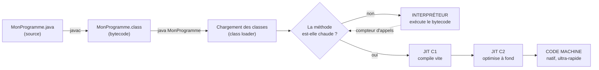

# Architecture de la JVM : chargement, JIT et exécution

> [!abstract] Ancre
> La JVM n'**interprète** pas ton code : elle le **compile à la volée** en code machine, pendant qu'il tourne, et **réécrit** les chemins chauds. C'est ce qui explique les « *warmup* », les benchmarks qui mentent, et pourquoi `System.currentTimeMillis()` autour d'une méthode ne mesure presque jamais ce que tu crois.

---

## 🧒 Avant de commencer : de quoi on parle

> [!tip] En clair
> Imagine un **traducteur simultané** dans une conférence.
>
> - **Au début**, il traduit **phrase par phrase**, un peu lentement : c'est l'**interpréteur**. Ça démarre **tout de suite**, mais ce n'est pas rapide.
> - **Au bout de 10 minutes**, il connaît les tournures récurrentes de l'orateur et **commence à traduire des blocs entiers d'avance** : c'est la **JIT** (compilation à la volée). Beaucoup plus rapide.
> - **Au bout d'une heure**, il **réécrit** carrément sa façon de traduire, en anticipant : c'est la **JIT « C2 »**, l'optimisation maximale.
>
> 🔑 **La JVM fait exactement ça.** C'est pourquoi une application Java est **lente au démarrage** puis **très rapide** — et pourquoi **la première exécution d'une méthode ne dit rien de sa vitesse réelle**.

**Les mots à connaître pour cette note :**

| Mot technique | En clair |
|---|---|
| **bytecode** | le « code intermédiaire » compilé par `javac` (`.class`) |
| **interpréteur** | exécute le bytecode **lentement mais tout de suite** |
| **JIT** *(Just-In-Time)* | compile le bytecode en **code machine**, à la volée |
| **HotSpot** | la JVM d'Oracle/OpenJDK : elle repère le code **chaud** |
| **C1 / C2** | les **deux compilateurs** : C1 rapide à produire, C2 optimisé |
| **tiered compilation** | le passage **C1 → C2** progressif |
| **warmup** | la période où la JVM compile et optimise (elle est **lente**) |
| **déoptimisation** | la JVM **annule** une optimisation devenue fausse |
| **class loading** | charger et vérifier les classes **au moment de l'usage** |
| **Metaspace** | où vivent les métadonnées de classes (hors heap) |

Voir aussi : [[java_memory_model]] (mémoire) et [[java_garbage_collection]] (allocation).

---

## Le parcours du code : de `.java` à l'exécution

> [!tip] En clair
> 🍞 **L'image du pain :** le `.java` est **la recette**, le `.class` (bytecode) est **la pâte préparée**, et la JVM est **le four** — qui **peut** cuire à toute vitesse, mais qui doit **chauffer** d'abord.



**Les quatre grandes phases :**

| Phase | Ce qui se passe | Coût |
|---|---|---|
| **Chargement** | les classes sont trouvées, lues, **vérifiées**, converties en structures internes | au démarrage, **paresseux** (à l'usage) |
| **Interprétation** | le bytecode est exécuté instruction par instruction | **rapide à démarrer**, lent à l'exécution |
| **Compilation JIT** | le code **chaud** est compilé en natif | **coûte** du CPU (mais une seule fois) |
| **Optimisation C2** | spéculations, inlining, élimination | **très** coûteux, **très** rentable |

---

## Le chargement des classes : paresseux, et hiérarchique

> [!tip] En clair
> 📚 **L'analogie de la bibliothèque :** la JVM ne lit **pas** tous les livres au démarrage. Elle les emprunte **au moment où on en a besoin** — et si un livre est **illisible** (classe absente), elle ne le sait qu'**à ce moment-là**.
>
> 🔑 **Conséquence très concrète :** c'est pour ça qu'une `NoClassDefFoundError` peut apparaître **des heures après** le démarrage, sur un chemin rarement emprunté.

**Les 3 phases du chargement d'une classe :**

| Phase | En clair |
|---|---|
| **Chargement** | trouver le `.class` (classpath, JAR, module…) et le lire |
| **Liaison** | **vérifier** le bytecode, préparer les champs, **résoudre** les références |
| **Initialisation** | exécuter les blocs `static` et les initialiseurs (⚠️ **une seule fois**, à la première utilisation) |

**La hiérarchie des class loaders (le modèle de délégation) :**

```
       Bootstrap (classes du JDK)          ← java.lang.String, etc.
            ▲  délègue vers le parent d'abord
       Platform / Extension
            ▲
       Application (ton classpath)          ← tes classes
            ▲
       (class loaders custom : plugins, OSGi, serveurs d'applis…)
```

> [!warning] Le piège du `static` et de l'initialisation paresseuse
> ```java
> public class Configuration {
>     static { chargerDepuisLeReseau(); }     // ⚠️ exécuté à la PREMIÈRE utilisation
>     ...
> }
> ```
> Le bloc statique s'exécute **quand la classe est utilisée pour la première fois** — pas au démarrage. Donc :
> - si c'est **lent**, ça bloque **le premier appelant** ;
> - si ça **échoue**, ça lève `ExceptionInInitializerError` **au moment de l'usage** ;
> - et la classe reste **définitivement** dans un état d'échec (`NoClassDefFoundError` ensuite).
>
> 🔑 **Réflexe : ne jamais faire d'I/O lourd dans un bloc `static`.** Utiliser une initialisation **paresseuse explicite**.

**Le cas de la « fuite de class loader » (serveurs d'applications)**

> [!tip] En clair
> Un conteneur (Tomcat, serveur d'applis) **recharge** ton application en créant un **nouveau** class loader. Si une classe de l'ancien loader reste référencée (thread non arrêté, `ThreadLocal`, cache `static`, driver JDBC…), **tout l'ancien loader reste en mémoire** — classes, metaspace, et ses objets. Un **redéploiement à chaud** répété finit par saturer le **Metaspace**.
>
> ✅ Réflexe : arrêter ses threads, vider ses `ThreadLocal`, désenregistrer les drivers et les `MBean`.

---

## La JIT : le vrai moteur de performance

> [!tip] En clair
> 🎯 **L'idée centrale :** la JVM **observe** ton programme en train de tourner. Quand une méthode est appelée **très souvent** (méthode « chaude »), elle la **compile en code machine natif** — et là, elle va **beaucoup plus vite** que l'interpréteur.
>
> Et elle va **plus vite que du C compilé statiquement**, parce qu'elle connaît **le comportement réel** du programme, pas juste le code source.

**Les deux compilateurs, et pourquoi ils sont deux :**

| | **C1** (client) | **C2** (server) |
|---|---|---|
| Objectif | compiler **vite** | compiler **bien** |
| Profondeur d'optimisation | limitée | **agressive** |
| Nombre d'appels pour déclencher | ~1 500 | ~10 000 |
| S'applique aux | méthodes fréquentes | **points chauds** |
| Compromis | démarrage rapide | débit maximal |

**La compilation par paliers (*tiered compilation*) :**

```
   Interpréteur  →  C1 (rapide, peu optimisé)  →  C2 (lent, très optimisé)
        ↑                     ↑                          ↑
    tout de suite      ~1 500 appels             ~10 000 appels
```

> [!tip] Pourquoi ce n'est pas « soit l'un soit l'autre »
> La JVM **commence par C1** — parce que si elle attendait C2, elle passerait plus de temps à compiler qu'à exécuter. On veut que le programme **soit vite correct**, pas qu'il démarre lentement. Puis, sur les **vraies zones chaudes**, elle passe en C2.
>
> **Conséquence :** ta méthode « lente » peut devenir **10× plus rapide** au bout de quelques milliers d'appels. Et la première mesure ne veut **rien dire**.

### Ce que la JIT fait vraiment (les optimisations qui comptent)

> [!tip] En clair
> Trois optimisations à connaître **par leur nom** — c'est ce qu'on attend d'un profil senior.

**① Inlining — « recopier le corps de la méthode »**

```java
public int doubler(int x) { return x * 2; }
public int calcul(int a) { return doubler(a) + 1; }
```

La JIT voit que `doubler` est **petit et appelé souvent** → elle **recopie son corps** dans `calcul`. Résultat : plus d'appel de méthode du tout.

> [!tip] L'image
> 👨🍳 C'est comme si le chef **connaissait par cœur** la recette du sous-chef, au lieu de lui demander à chaque fois. **Plus besoin de se parler** → beaucoup plus rapide.
>
> 🔑 **C'est l'optimisation la plus importante de la JVM** — presque toutes les autres en dépendent.

**② Élimination de code mort & constant folding**

```java
if (DEBUG) { logger.debug("..."); }     // avec static final boolean DEBUG = false;
```

La JIT voit que `DEBUG` est **une constante `false`** → le bloc est **totalement supprimé** du code compilé. **Zéro coût à l'exécution.** C'est pour ça qu'on peut écrire des traces de debug et les laisser dans le code.

**③ Spéculation de type et dévirtualisation**

```java
Animal a = new Chien();
a.crier();       // la JIT observe : "toujours un Chien ici"
```

Même si `Animal` a **dix** sous-classes, la JIT constate qu'à **ce point** l'objet est **toujours** un `Chien` → elle appelle la méthode **directement**, sans passer par la table virtuelle.

> [!warning] Et c'est là qu'arrive la déoptimisation
> Si **un jour** un `Chat` apparaît à cet endroit, la JIT **invalide** son optimisation — c'est la **déoptimisation**. Elle revient en arrière et recompile sans la spéculation.
>
> 🔑 **Conséquence :** un programme qui passe **très vite** peut **ralentir brutalement** au moment où ce cas rare survient. Et le « profilage » fait au mauvais moment peut donner une vision **complètement fausse**.

**Le seuil d'inlining (à connaître)**

> [!tip] En clair
> La JIT n'inline que les méthodes **petites** (par défaut, **~325 octets de bytecode**, soit `-XX:MaxInlineSize=35` en unités internes). Au-delà, elle **ne le fait pas**.
>
> ⇒ **Une méthode trop longue ne sera jamais inlinée**, donc jamais aussi vite. **Découper les méthodes en unités courtes n'est pas seulement plus lisible — c'est aussi plus rapide.**

---

## Ce qui peut tuer la JIT (et donc ta performance)

> [!tip] En clair
> La JIT est **puissante**, mais **fragile** : certaines constructions l'empêchent d'optimiser. Les connaître, c'est savoir **pourquoi** une partie du code reste lente.

| Ce qui bloque | Pourquoi |
|---|---|
| **`synchronized`** sur un chemin chaud | barrières mémoire qui interdisent certaines optimisations |
| **Polymorphisme sauvage** (5+ implémentations d'une interface au même endroit) | la JIT **abandonne** la dévirtualisation (limite ≈ 2-3 types, en « *bimorphic* / *polymorphic* inlining ») |
| **`try/catch` dans une boucle chaude** | blocage de certaines optimisations |
| **`volatile` sur un chemin chaud** | barrière mémoire à chaque accès |
| **Reflection / `MethodHandle` non stabilisés** | la JIT ne peut pas inliner |
| **Méthode trop grosse** | au-delà du seuil, **pas d'inlining** |
| **`System.gc()` explicite** | casse les hypothèses de gestion mémoire |

> [!note] Le point qui étonne : `System.currentTimeMillis()` fausse les mesures
> Mesurer une méthode avec `System.nanoTime()` **autour d'un seul appel** est presque toujours **faux** :
> - la méthode n'est peut-être **pas encore compilée** (interpréteur) ;
> - la JIT peut **supprimer** le calcul s'il n'a **aucun effet observable** ;
> - la **première** exécution est toujours **lente** (chargement, résolution, compilation).
>
> ✅ **La solution : `JMH` (Java Microbenchmark Harness).** C'est **l'outil officiel** pour mesurer en Java : il gère le *warmup*, les « morts de code », les boucles, et la compilation en cours de mesure. **Ne jamais faire de micro-benchmark maison.**

---

## La mémoire de la JVM : qui vit où

> [!tip] En clair
> 🗺️ **La carte des régions** — à connaître, on en parle en entretien.

```
┌─────────────────────────── JVM ────────────────────────────┐
│                                                            │
│   HEAP  (partagée, garbage-collectée)     ← voir GC note   │
│   ├── Young (Eden + Survivor)   ← objets jeunes            │
│   └── Old / Tenured             ← objets qui survivent     │
│                                                            │
│   METASPACE  (métadonnées de classes)     ← hors heap !    │
│   ├── structure des classes, méthodes, bytecode            │
│   └── ⚠️ garbage-collectée aussi, mais séparément          │
│                                                            │
│   CODE CACHE  (code machine compilé par la JIT)            │
│   └── ⚠️ si plein : la JIT ARRÊTE de compiler              │
│                                                            │
│   ┌── STACK (par thread, privé) ──┐  ┌── PC, natif ──┐     │
│   │ variables locales, appels     │  │ programme     │     │
│   └────────────────────────────────┘  └───────────────┘    │
└────────────────────────────────────────────────────────────┘
```

| Région | Contenu | Réglage |
|---|---|---|
| **Heap** | les **objets** | `-Xmx` (max), `-Xms` (initial) |
| **Metaspace** | métadonnées de **classes** | `-XX:MaxMetaspaceSize` (⚠️ **hors** heap, par défaut illimité) |
| **Code cache** | code **compilé par la JIT** | `-XX:ReservedCodeCacheSize` (⚠️ s'il est plein, la JIT arrête d'optimiser) |
| **Stack** | variables locales par thread | `-Xss` (attention × nombre de threads) |

> [!warning] Les deux régions qu'on oublie
> **1. Metaspace non borné** → un chargement de classes excessif (proxies générés, redéploiements, `ClassLoader` fuités) remplit la **mémoire hors heap**. Symptôme : `OutOfMemoryError: Metaspace` alors que `-Xmx` n'est **pas** atteint.
>
> **2. Code cache plein** → la JVM **cesse d'optimiser** (« *CodeCache is full* » dans les logs). L'application continue, mais **ralentit** à mesure que la JIT se désactive. ⚠️ **Invisible** si on ne surveille pas les logs de la JVM.

---

## Exemple concret : le benchmark qui ment

> [!tip] En clair
> **Le scénario le plus courant du métier** : « j'ai chronométré ma méthode, elle est lente ». Voyons ce qui se passe vraiment.

### ❌ Le benchmark naïf

```java
// "Je vais mesurer combien de temps prend mon calcul"
long debut = System.nanoTime();
int resultat = calculComplexe(42);
long fin = System.nanoTime();
System.out.println("Durée : " + (fin - debut) + " ns");

// "Et en boucle, pour être sûr"
long d1 = System.nanoTime();
for (int i = 0; i < 1_000_000; i++) calculComplexe(i);
long d2 = System.nanoTime();
System.out.println("Total : " + (d2 - d1) + " ns");
```

**Ce qui va mal se passer :**

| Problème | Effet |
|---|---|
| **Le premier appel est interprété** | la 1ʳᵉ mesure est **10 à 100× trop lente** |
| **La JIT compile pendant la boucle** | les 1ers milliers d'itérations sont lents, les suivants ultra-rapides → **moyenne fausse** |
| **Code mort** | si `calculComplexe(i)` n'a **aucun effet observable**, la JIT peut **supprimer la boucle entière** → durée ≈ **0 ns** |
| **Le graphe de hot-spot n'est pas encore peuplé** | la JVM **continue** d'optimiser à la fin de la mesure |
| **Pas de `-Xmx` fixé** | un GC peut survenir **pendant** la mesure |

### ✅ La démarche correcte

```
① Écrire un benchmark JMH (jamais un `System.nanoTime()` maison)
② Le laisser faire son WARMUP (par défaut : plusieurs secondes)
③ Mesurer sur des itérations STABLES
④ Faire varier le -Xmx et le GC pour vérifier la sensibilité
⑤ Profiler (JFR, async-profiler) pour savoir OÙ le temps est passé,
   pas seulement COMBIEN
```

**Le point à retenir :**

> [!warning] Ce que « la JVM chauffe » implique pour toi
> **Toute mesure faite avant le warmup est fausse.** Et **toute conclusion tirée d'un test unitaire de 3 lignes est fausse** par construction — parce que la JVM n'a **pas eu le temps** d'optimiser.
>
> 🔑 **Conséquence pratique :** une partie « lente » en test peut être **rapide** en production (après 10 000 appels), et inversement. **Seul un benchmark JMH + un profiler sur une application chaude** dit la vérité.

---

## Les flags JVM à connaître (le minimum vital)

> [!tip] En clair
> Il y en a des centaines. Voici les **six** qui servent vraiment à expliquer ou diagnostiquer.

| Flag | Ce qu'il fait | Pourquoi c'est utile |
|---|---|---|
| `-Xms` / `-Xmx` | taille initiale / max du **heap** | ✅ **toujours** les fixer égaux en production (évite le redimensionnement) |
| `-XX:MaxMetaspaceSize` | borne le **Metaspace** | ⚠️ évite la fuite silencieuse hors heap |
| `-XX:+HeapDumpOnOutOfMemoryError` | écrit un **heap dump** avant de mourir | ✅ indispensable pour diagnostiquer un OOM |
| `-XX:+PrintCompilation` | log la **compilation JIT** | comprendre le warmup |
| `-XX:+PrintGCDetails` *(ou `-Xlog:gc*`)* | log le **GC** | voir les pauses |
| `-XX:+UseZGC` / `-XX:+UseG1GC` | choisir le **collecteur** | voir [[java_garbage_collection]] |

> [!note] `-Xms` = `-Xmx` : le détail qui fait mal
> Si `-Xmx` est plus grand que `-Xms`, la JVM **agrandit le heap à chaud** — et cette croissance provoque des **GC complets** imprévisibles. En production, **fixer les deux à la même valeur** : la JVM réserve tout d'un coup, et les pauses deviennent **prévisibles**.
>
> ⚠️ Conséquence en conteneur : la limite mémoire du conteneur doit être **plus grande** que `-Xmx` (le Metaspace, les threads, le code cache vivent **en dehors**).

---

## Pièges fréquents

> [!tip] En clair
> **Les 5 erreurs à retenir :**
> 1. **Mesurer sans warmup** → la JIT n'a pas encore compilé, la mesure est fausse.
> 2. **Faire un micro-benchmark maison** → la JIT supprime le code, ou le compile pendant la mesure.
> 3. **I/O lourd dans un bloc `static`** → bloque le **premier** appelant, échoue tard.
> 4. **Oublier le Metaspace et le code cache** → OOM hors heap, ralentissement invisible.
> 5. **Croire que la JVM est un interpréteur** → elle compile et **optimise**, parfois mieux que le statique.

- **Benchmark sans warmup** — la/les premières exécutions sont **interprétées** puis **C1** puis **C2**. Réflexe : **JMH**, ou au minimum ignorer les N premières itérations.
- **Benchmark maison avec `System.nanoTime()`** — code mort supprimé, compilation pendant la mesure, résultats non reproductibles. Réflexe : **JMH**.
- **Supposer qu'un test unitaire reflète la performance** — il reflète le **pire** cas (interpréteur). Réflexe : mesurer sur une application **chaude** et **chargée**.
- **I/O dans un initialiseur `static`** — latence au premier usage, `ExceptionInInitializerError` tardive, classe **définitivement** cassée. Réflexe : initialisation paresseuse explicite.
- **Fuite de `ClassLoader`** — un thread ou un `ThreadLocal` non nettoyé retient tout le loader. Réflexe : arrêt propre des composants, `ThreadLocal.remove()`.
- **Méthodes géantes** — au-delà du seuil d'inlining, jamais optimisées. Réflexe : découper en méthodes **courtes**.
- **Polymorphisme sauvage** — 5+ types au même site d'appel annulent la dévirtualisation. Réflexe : **mesurer** avant d'accuser le design ; parfois un `if/else` sur un type est plus rapide, mais **rarement** un bon compromis de lisibilité.
- **`-Xmx` non fixé en conteneur** — la JVM s'adapte à la limite du conteneur, mais le **Metaspace** et les **threads** s'ajoutent par-dessus. Réflexe : `-Xmx` **strictement inférieur** à la limite du conteneur.
- **Metaspace illimité** — une fuite de classes remplit la mémoire **hors heap**, invisible dans les métriques de heap. Réflexe : `-XX:MaxMetaspaceSize` + surveillance.
- **Code cache plein ignoré** — la JIT se désactive silencieusement, l'appli ralentit. Réflexe : surveiller les logs JVM et le flag `-XX:+PrintCodeCache`.
- **Croire que `System.gc()` aide** — il **déclenche** un GC complet, casse les optimisations, et n'est qu'une **suggestion** (`-XX:+DisableExplicitGC` pour l'ignorer). Réflexe : ne jamais l'appeler en production.

---

## Rappel

> [!question] Question de rappel
> Tu mesures une méthode avec `System.nanoTime()` juste après le démarrage : elle « prend » 800 µs. Dans un test de charge de 30 minutes, l'application affiche 15 µs pour la même opération. Laquelle des deux mesures est « la vraie », et pourquoi ? Que se passera-t-il si tu utilises la mesure longue dans un test unitaire ?

> [!success]- Réponse
> **Aucune des deux n'est « la vraie » : elle mesurent deux régimes d'exécution différents.** La première (800 µs) mesure une méthode **interprétée**, avant compilation : c'est le régime du **démarrage**. La seconde (15 µs) mesure le **même code compilé par C2**, avec les optimisations appliquées (inlining, élimination de code, dévirtualisation) : c'est le régime de **production à chaud**. **Ni l'une ni l'autre n'est fausse** — elles décrivent des moments différents de la vie de la JVM, et le vrai danger est de **comparer** les deux ou de généraliser à partir d'une seule. **Si tu utilises la mesure longue (15 µs) dans un test unitaire** : le test sera **faux par construction**. Un appel isolé ne bénéficie d'**aucune** optimisation — il n'a pas atteint le seuil de compilation (~1 500 appels pour C1, ~10 000 pour C2), la JVM n'a rien observé, et la mesure reflétera le pire cas (interpréteur, classes fraîchement chargées). **La conclusion correcte :** mesurer la **performance** exige de reproduire le **régime de production** — un benchmark **JMH** avec warmup, sur un code compilé. Et pour savoir **où** le temps passe (pas seulement combien), il faut **profiler** (JFR, async-profiler — voir [[java_performance_profiling]]).

### 🎯 Le résumé à retenir

> [!tip] Si tu ne retiens qu'une chose
> **La JVM n'interprète pas : elle observe, compile et réécrit ton code chaud.**
>
> - **Class loading** : **paresseux** → une erreur de classe peut survenir des heures après le démarrage.
> - **Interpréteur → C1 → C2** : le code **chauffe**. Les premières mesures ne veulent **rien dire**.
> - **Inlining** = l'optimisation la plus importante. **Méthodes courtes = méthodes rapides.**
> - **Spéculation + déoptimisation** : un programme peut **ralentir brutalement** quand un cas rare apparaît.
> - **Metaspace et code cache vivent HORS du heap** → deux sources d'OOM et de lenteur **invisibles**.
> - **JMH pour les benchmarks.** Jamais de micro-benchmark maison.
>
> **Et le réflexe de senior :** devant un chiffre de performance, demander d'abord **« la JVM, elle avait chauffé combien de temps ? »**

---

## 🗣️ Les questions qu'on te posera

> [!tip] En clair
> Les questions classiques sur le sujet, et la réponse courte qui résume l'essentiel.

| Si on te demande… | Réponds… |
|---|---|
| **« La JVM est-elle un interpréteur ? »** | « **Non** : elle interprète au début, puis **compile à la volée** les méthodes chaudes. Elle optimise parfois **mieux** que du code compilé statiquement. » |
| **« C'est quoi le warmup ? »** | « La période où la JVM charge, interprète, puis compile. **Lente par nature** — et elle rend toute mesure précoce **fausse**. » |
| **« C1 ou C2 ? »** | « **C1** compile vite, peu optimum ; **C2** compile lentement mais optimise à fond. Tiered compilation = **C1 puis C2** sur les points chauds. » |
| **« C'est quoi l'inlining ? »** | « Recopier le corps d'une méthode appelée fréquemment → supprime l'appel. C'est la base de **presque toutes** les autres optimisations. » |
| **« C'est quoi la déoptimisation ? »** | « La JVM **annule** une optimisation devenue fausse (ex. une spéculation de type qui ne tient plus) et recompile. D'où des **ralentissements brutaux**. » |
| **« Où vivent les classes ? »** | « Dans le **Metaspace**, **hors du heap**. Une fuite de `ClassLoader` le remplit → `OOM: Metaspace` sans que `-Xmx` soit atteint. » |
| **« Comment mesurer du Java ? »** | « **JMH** avec warmup. Jamais `System.nanoTime()` autour d'un appel : la JIT peut supprimer le code mesuré. » |

> [!tip] La phrase qui tue
> **« La JVM n'interprète pas : elle observe, compile et réécrit — donc toute mesure faite avant que le code ait chauffé décrit un autre programme que celui qui tourne en production. »**

---

## Voir aussi

- [[java_memory_model]] — visibilité et `happens-before` (le prérequis).
- [[java_jmm_concurrency]] — verrous, atomics et leur coût pour la JIT.
- [[java_threads_executors]] — comment la JVM planifie l'exécution.
- [[java_garbage_collection]] — la gestion mémoire : heap, générations, collecteurs.
- [[java_performance_profiling]] — mesurer et diagnostiquer pour de vrai (JFR, async-profiler).
- [[index]] — carte d'entrée du domaine Java.

## Références

- JVMS — *Java Virtual Machine Specification* (format des classes, chargement, vérification).
- Oracle — *HotSpot Virtual Machine Performance Enhancements* (JIT, tiered compilation, flags).
- Scott Oaks — *Java Performance: The Definitive Guide* (mesure, JIT, mémoire).
- JEP 802 — *JVM Constants API* et documentation HotSpot sur l'inlining.
- OpenJDK — *JMH (Java Microbenchmark Harness)*, la référence pour mesurer en Java.
