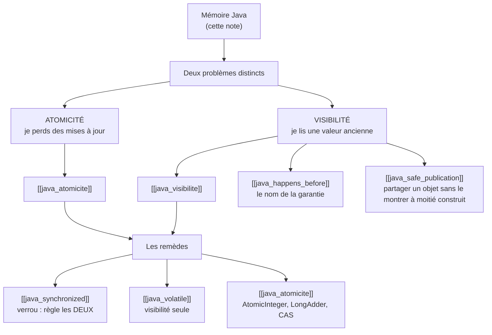

# Mémoire Java : ce qui est partagé entre threads

> [!abstract] Ancre
> Cette note est **la carte d'ensemble** : où vivent les données, ce que plusieurs threads partagent vraiment, et le **seul** problème qui en découle. Elle est **courte exprès** — chaque notion a sa propre note, reliée en bas.

---

## 🧒 Avant de commencer : de quoi on parle

> [!tip] En clair
> Un programme Java à **un seul thread**, c'est un **cuisinier seul dans sa cuisine**. Il fait quelque chose, il le voit fait. **Jamais de surprise.**
>
> Dès qu'on met **deux cuisiniers dans la même cuisine**, une question nouvelle apparaît — et elle n'existait pas avant :
>
> **« Si je mets du beurre dans le frigo, est-ce que l'autre le sait tout de suite ? »**
>
> 🔑 **Toute cette famille de notes existe pour répondre à cette seule question.**
>
> **Et la réponse de Java est surprenante :** *« Pas forcément. Pas sans que tu l'aies demandé explicitement. »*

**Les mots dont tu as besoin — et seulement ceux-là :**

| Mot technique | En clair |
|---|---|
| **thread** | un **fil d'exécution** : un cuisinier qui travaille en parallèle des autres |
| **heap** | la **mémoire commune** : là où vivent les objets |
| **stack** | la **mémoire privée d'un thread** : ses variables locales, ses appels de méthode |
| **variable locale** | déclarée **dans une méthode** — elle n'appartient qu'à ce thread |
| **champ** | déclarée **dans une classe** (`private int solde`) — elle appartient à **l'objet** |
| **visibilité** | « est-ce que je vois ce que l'autre vient d'écrire ? » |
| **data race** | deux threads touchent la même donnée, dont au moins une écriture, **sans coordination** |

> 📌 **Un seul terme à retenir vraiment ici : la différence entre une *variable locale* et un *champ*.** Tout le reste en découle.

---

## 1. Un seul thread : rien à signaler

> [!tip] En clair
> On commence par le cas simple, parce qu'il est **la référence** — et parce qu'il **fonctionne toujours**.

```java
public class Compte {
    private int solde = 0;                      // ← un CHAMP (il vit dans l'objet)

    public void deposer(int montant) {
        int nouveau = this.solde + montant;     // ← 'nouveau' est une VARIABLE LOCALE
        this.solde = nouveau;
    }
}
```

| Ce que c'est | Où ça vit | Qui peut y toucher |
|---|---|---|
| `solde` — le **champ** | dans l'**objet** (donc dans la **heap**) | **tous** les threads qui ont une référence vers cet objet |
| `nouveau` — la **variable locale** | sur la **stack** du thread | **ce thread uniquement** |

> 🔑 **Avec un seul thread :** personne d'autre ne touche `solde`, donc l'enchaînement *lire → calculer → écrire* se passe **toujours bien**. **Aucun problème à résoudre.**

---

## 2. Deux threads : le problème apparaît

> [!tip] En clair
> 🏦 **Le scénario, sur un terrain connu.** Deux **virements** arrivent **en même temps** sur le **même compte**. Deux threads traitent les requêtes, chacun dans sa méthode `deposer`.

```
   Thread A : dépose 100 €              Thread B : dépose 50 €
   ─────────────────────────            ─────────────────────────
                    solde = 1000
   lit solde → 1000
                                        lit solde → 1000
   calcule 1000 + 100 = 1100
                                        calcule 1000 + 50 = 1050
   écrit solde = 1100
                                        écrit solde = 1050   ← ÉCRASE !
                    solde = 1050        ❌ les 100 € ont DISPARU
```

**Attendu :** 1150 €. **Obtenu :** 1050 €. **Différence :** 100 € perdus — **sans erreur, sans log, sans trace.**

> [!warning] Ce que ce scénario nous apprend — et c'est tout le programme
> Ce qui a l'air d'**une seule action** (`solde = solde + montant`) est en réalité **trois étapes** :
>
> **lire → calculer → écrire**
>
> Entre le *lire* et l'*écrire*, **quelqu'un d'autre peut passer**. C'est ce qu'on appelle une **data race**.
>
> Et voilà le point crucial : **ce n'est pas le seul problème.** Il y en a **deux**, et ils sont **totalement différents.**

---

## 3. Les deux problèmes (à ne jamais confondre)

> [!tip] La clé de lecture de tout le dossier
> C'est **LE tableau** de cette note. Deux problèmes, deux noms, deux remèdes **différents**.

| | **Le problème d'ATOMICITÉ** | **Le problème de VISIBILITÉ** |
|---|---|---|
| **La question** | « mes opérations peuvent-elles **s'entremêler** ? » | « est-ce que je **vois** ce que l'autre vient d'écrire ? » |
| **Le symptôme** | je **perds** des mises à jour (les 100 € !) | je reste bloqué sur une **valeur ancienne** |
| **Dans notre exemple** | A et B calculent **en même temps** depuis la même valeur | B continue à lire `1000` alors que A a écrit `1100` |
| **Sa note** | [[java_atomicite]] | [[java_visibilite]] |

> ⚠️ **Pourquoi les séparer absolument :**
> On pourrait croire qu'**un seul remède** règle les deux. **C'est faux** — et c'est l'erreur n°1 en concurrence.
>
> | Outil | Règle l'atomicité ? | Règle la visibilité ? |
> |---|---|---|
> | `volatile` | ❌ **non** | ✅ oui |
> | `AtomicInteger` | ✅ oui | ✅ oui (dans son usage normal) |
> | `synchronized` | ✅ oui | ✅ oui |

---

## 4. Le contrat de Java, en une phrase

> [!tip] En clair
> Voici **la règle fondatrice** — celle dont **tout le reste** découle :
>
> **En Java, deux threads qui accèdent à la même donnée SANS coordination ne bénéficient d'AUCUNE garantie.**
>
> Ni sur **quand** ils voient les écritures de l'autre. Ni sur **l'ordre** des opérations. Ce n'est pas « ça peut être en retard » — c'est **« il n'y a aucune garantie du tout »**.

**⚠️ Ce que cette règle ne veut PAS dire — trois pièges de lecture :**

> [!warning] À ne pas croire (ce sont des erreurs fréquentes)
> **❌ « Chaque thread garde une copie privée de chaque variable. »**
> → **Faux si on le prend au pied de la lettre.** Java **ne crée pas** systématiquement une copie. C'est une **image** utile pour *intuiter* le problème — pas une description du mécanisme. La formulation juste est celle du dessus : **« pas de garantie sans coordination »**.
>
> **❌ « Un thread peut voir une valeur qui n'a jamais existé. »**
> → **Trop fort.** Le modèle Java **impose des règles précises** aux exécutions autorisées. Ce qu'on peut observer, c'est : une **valeur ancienne**, une **écriture perdue**, ou **l'effet d'un réordonnancement**. Jamais « n'importe quoi ».
>
> **❌ « Toutes les variables locales sont physiquement dans la stack, tous les champs dans la heap. »**
> → **C'est un modèle pour raisonner, pas une garantie d'implémentation.** La JVM peut optimiser le stockage (un objet qui ne « s'échappe » pas peut vivre sur la stack). Le modèle reste **utile**, mais ce n'est pas une vérité physique absolue.

---

## 5. Le mot que tu verras partout : `happens-before`

> [!tip] En clair
> Tous les remèdes (`volatile`, `synchronized`, `Atomic*`…) ont un point commun : ils **créent une relation** entre deux accès, qui **garantit** l'ordre et la visibilité.
>
> Cette relation a un nom : **`happens-before`**.
>
> 🔑 **Ici, tu n'as besoin que de retenir ceci :**
>
> *« `happens-before` est le nom technique de la garantie. Créer cette garantie, c'est exactement ce que font `volatile`, `synchronized`, ou le démarrage d'un thread. »*
>
> 👉 **La relation complète (ses règles, une par une) est dans [[java_happens_before]].** Tu **n'en as pas besoin** pour lire cette note.

---

## 6. Où aller ensuite

> [!tip] En clair
> Voici la carte. **Chaque problème a sa note, chaque remède a sa note.** Lis dans l'ordre, ou pioche selon ton besoin.



| Note | Ce qu'elle répond |
|---|---|
| [[java_visibilite]] | « pourquoi je lis une valeur ancienne ? » |
| [[java_atomicite]] | « pourquoi je perds des mises à jour ? et c'est quoi CAS ? » |
| [[java_synchronized]] | « comment protéger une section de code ? » |
| [[java_volatile]] | « quand `volatile` suffit-il, et quand ne suffit-il pas ? » |
| [[java_happens_before]] | « c'est quoi cette garantie, exactement ? » |
| [[java_safe_publication]] | « comment partager un objet sans qu'on le voie à moitié construit ? » |
| [[java_jmm_concurrency]] | **la synthèse** : choisir le bon outil, deadlocks, contention |

---

## Pièges fréquents

> [!tip] En clair
> **Les 5 erreurs de raisonnement à éviter sur ce sujet :**
> 1. **Croire qu'un bug concurrent se voit en test** → il faut de la **charge** et **plusieurs cœurs**. En local, ça marche souvent.
> 2. **Confondre atomicité et visibilité** → deux problèmes, deux remèdes.
> 3. **Croire que `volatile` rend une opération atomique** → il ne le fait **pas**.
> 4. **Se dire « c'est théorique »** → non : c'est de l'argent perdu, silencieusement.
> 5. **Vouloir tout synchroniser « au cas où »** → ça crée de la **contention**, sans corriger le fond.

- **« Ça marche chez moi »** — un bug de visibilité dépend de la **charge** et du **nombre de cœurs**. Un test mono-thread ne prouvera **jamais** rien. Réflexe : raisonner en **garanties**, pas en observations.
- **Confondre les deux problèmes** — c'est l'erreur n°1. Réflexe : devant un bug concurrent, demander d'abord *« j'ai perdu une mise à jour, ou je lis une vieille valeur ? »*
- **Prendre une image pour une description** — les analogies aident à **intuiter**, mais Java n'en fait pas une **garantie**. Réflexe : l'image pour comprendre, la **règle** pour décider.
- **Ne synchroniser qu'un côté** — protéger l'écriture mais pas la lecture (ou l'inverse) ne protège **rien**. Réflexe : **tous** les accès à la donnée doivent respecter **la même** stratégie.
- **Sur-synchroniser par réflexe** — des `synchronized` partout transforment l'application en **goulot d'étranglement**. Réflexe : identifier **l'invariant** à protéger, puis choisir l'outil le plus léger qui le garantit.

---

## Rappel

> [!question] Question de rappel
> Deux threads débitent le même compte en même temps. Solde initial : 1000 €. L'un débite 100 €, l'autre 50 €. Le solde final est de **950 €**. **Qu'est-ce qui s'est passé — atomicité ou visibilité ?**

> [!success]- Réponse
> **C'est un problème d'atomicité.** L'opération `solde = solde - montant` se décompose en **trois étapes** : *lire*, *calculer*, *écrire*. Les deux threads ont **lu `1000` en même temps**, avant que l'autre ait écrit. Chacun a calculé de son côté, et le **dernier à écrire a écrasé** le résultat de l'autre : un débit a été perdu. Le solde final (950) correspond à **un seul** des deux débits appliqué au solde initial. **Pourquoi ce n'est pas de la visibilité :** un problème de visibilité se manifesterait par un thread lisant une valeur **ancienne** et restant dessus. Ici, les deux threads ont bien lu **la même valeur, au même moment** — c'est l'**enchaînement** des trois étapes qui a été cassé. **Le remède :** rendre l'opération **atomique** — `synchronized` (verrou) ou `AtomicInteger`. Voir [[java_atomicite]] et [[java_synchronized]].

### 🎯 Le résumé à retenir

> [!tip] Si tu ne retiens qu'une chose
> **Un seul thread : rien à faire. Deux threads sur la même donnée : plus aucune garantie par défaut.**
>
> - **heap** = partagée · **stack** = privée · **champ** = dans l'objet · **variable locale** = dans la méthode
> - **Deux problèmes distincts** : **atomicité** (je perds des mises à jour) et **visibilité** (je lis une valeur ancienne)
> - **Un seul remède ne couvre pas les deux** : `volatile` → visibilité · `Atomic*` → atomicité · `synchronized` → les deux
> - **`happens-before`** = le nom de la garantie que créent ces outils → voir [[java_happens_before]]
>
> **Et le réflexe :** devant un bug concurrent, ne pas demander *« quel outil ? »* mais **« quel problème, exactement ? »**

---

## 🗣️ Les questions qu'on te posera

> [!tip] En clair
> Les questions classiques sur le sujet, et la réponse courte qui résume l'essentiel.

| Si on te demande… | Réponds… |
|---|---|
| **« C'est quoi le Java Memory Model ? »** | « Le **contrat** qui définit quand une écriture d'un thread devient visible pour un autre. Sans coordination : **aucune** garantie. » |
| **« Ça sert à quoi, concrètement ? »** | « À comprendre pourquoi deux threads sur la même donnée peuvent perdre une mise à jour ou lire une valeur périmée — **silencieusement**. » |
| **« Atomicité ou visibilité ? »** | « **Atomicité** : mes opérations s'entremêlent → je **perds** des mises à jour. **Visibilité** : je ne vois pas ce qui a été écrit → je lis une valeur **ancienne**. » |
| **« Un remède pour les deux ? »** | « Seul **`synchronized`** couvre les deux. `volatile` ne règle que la visibilité, `Atomic*` que l'atomicité. » |
| **« Pourquoi ça ne casse jamais en test ? »** | « Ça dépend de la **charge** et du **nombre de cœurs**. En local, peu de charge et peu de cœurs donnent souvent l'illusion que ça marche. » |
| **« Où vivent les données ? »** | « Les **objets** et leurs **champs** dans la **heap** (partagée). Les **variables locales** sur la **stack** du thread. C'est un modèle pour raisonner. » |

> [!tip] La phrase qui tue
> **« Un thread, ça va. Deux threads sur la même donnée sans coordination, et Java ne garantit plus rien : ni quand tu vois les écritures de l'autre, ni dans quel ordre elles arrivent. »**

---

---

## 🔗 Pour aller plus loin

> [!tip] En clair
> Cette note te donne **la carte**. Pour le **cours complet** — les règles de `happens-before` une par une, les trois remèdes (`volatile`, `synchronized`, `AtomicInteger`), la *safe publication* et un exemple chiffré — c'est ici :
>
> ➡️ **[[java_memory_model|JMM en profondeur : happens-before et les 3 remèdes]]**

## Voir aussi

- [[java_visibilite]] — le problème n°1 : je lis une valeur ancienne.
- [[java_atomicite]] — le problème n°2 : je perds des mises à jour. Et CAS.
- [[java_happens_before]] — le nom de la garantie, et ses règles.
- [[java_synchronized]] — le verrou : règle les deux problèmes.
- [[java_volatile]] — la visibilité seule, sans verrou.
- [[java_safe_publication]] — partager un objet sans qu'il soit vu à moitié construit.
- [[java_jmm_concurrency]] — la synthèse : choisir l'outil, deadlocks, contention.
- [[java_threads_executors]] — qui exécute tout ça : pools et virtual threads.
- [[index]] — carte d'entrée du domaine Java.

## Références

- JLS — *Java Language Specification*, **§17 Threads and Locks** : la spécification normative du modèle mémoire.
- JSR-133 — *Java Memory Model and Thread Specification* (la refonte de Java 5).
- Brian Goetz et al. — *Java Concurrency in Practice*, chapitre 3 « Sharing Objects » (la référence pratique).
