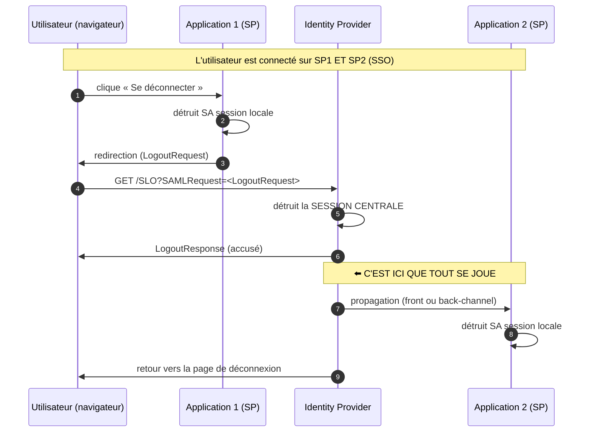

# Single Logout (SLO)

> [!abstract] Ancre
> Le **Single Logout** est la déconnexion **propagée** en SAML : quand l'utilisateur se déconnecte d'une application, l'IdP prévient **les autres applications** pour qu'elles ferment **aussi** leur session. Sans lui, « se déconnecter » ne déconnecte qu'une application sur N.

---

## 🧒 Avant de commencer : de quoi on parle

> [!tip] En clair
> Tu te déconnectes d'une application. Tu crois être déconnecté **partout**. En réalité :
>
> - L'application en question t'a oublié. ✅
> - **Les autres applications n'en savent rien** — elles te croient encore connecté. ⚠️
>
> 🔑 **L'analogie du badge d'entreprise :** tu rends ton badge au **poste de sécurité** (l'IdP). Mais les **portes que tu as déjà franchies** restent ouvertes derrière toi. Si quelqu'un passe après toi, il entre dans ton bureau.
>
> **Le SLO, c'est le standard qui dit au poste de sécurité : « préviens toutes les portes de se refermer ».**

**Les mots à connaître pour cette note :**

| Mot technique | En clair |
|---|---|
| **SP-initiated logout** | la **déconnexion part de l'application** (l'utilisateur clique « se déconnecter ») |
| **IdP-initiated logout** | la **déconnexion part de l'IdP** (le portail, ou un administrateur) |
| **`LogoutRequest`** | le message SAML : « ferme la session de cet utilisateur » |
| **`LogoutResponse`** | l'accusé de réception : « c'est fait » |
| **`SessionIndex`** | ⭐ l'identifiant de **la session concernée** (l'équivalent du `sid` en OIDC) |
| **`NameID`** | l'identifiant de l'utilisateur (déjà vu dans [[saml_nameid]]) |
| **front-channel** | le message passe **par le navigateur** |
| **back-channel** | le message passe **serveur à serveur** (fiable) |

Voir aussi : [[security/oidc/logout|logout OIDC]] (le même problème résolu côté OIDC) et [[sso_session_and_consent]].

---

## Définition

> [!tip] En clair
> « Se déconnecter » recouvre **trois opérations différentes**, qu'il faut absolument distinguer :
>
> 1. **Oublier l'utilisateur dans l'application** (supprimer son cookie local).
> 2. **Détruire la session chez l'IdP** (supprimer la session centrale).
> 3. **Prévenir les autres applications** qu'elles doivent fermer leur session. ⬅️ **c'est le SLO**
>
> La plupart des failles de sécurité viennent du fait qu'on fait **seulement la n°1** en croyant avoir fait les trois.

Le **Single Logout** est le **profil SAML 2.0** (*Profiles*, §4.4) qui normalise la **fin de session propagée** : un `LogoutRequest` est envoyé à l'IdP (ou par l'IdP) et parcourt l'ensemble des partenaires ayant une session active pour cet utilisateur, chacun devant la fermer et répondre par un `LogoutResponse`.

**Il est optionnel dans le standard** — et c'est précisément ce qui fait sa réputation : **peu implémenté, mal implémenté, ou laissé de côté**.

---

## Enjeux

> [!tip] En clair
> **Pourquoi la déconnexion mérite-t-elle une note à part ?**
>
> Parce que le SSO crée un **effet de concentration** : une seule authentification ouvre **plusieurs** applications. Si la fermeture est incomplète, l'accès **survit** — là où on ne l'attend pas.

- **Poste partagé** : le scénario critique. Un logout incomplet laisse un compte accessible à la personne suivante.
- **Le cookie appartient à l'IdP** : une application **ne peut pas** supprimer la session centrale — elle ne peut que le **demander**.
- **Chaque SP a sa propre session** : il n'existe **aucun** mécanisme automatique — il faut **propager**.
- **Fenêtre de faille** : sans propagation, un SP ne s'aperçoit de rien avant **sa prochaine vérification** (ou l'expiration de son jeton).
- **Le paradoxe du SLO** : c'est **le profil le plus demandé par les audits** et **le moins bien implémenté** en pratique. Un classique du terrain.

---

## Fonctionnement détaillé

### Le problème : chaque session est indépendante

> [!tip] En clair
> **Le point qui surprend :** une application **ne peut pas** supprimer la session de l'IdP. Le cookie de session appartient au **domaine de l'IdP** — une application sur `app1.exemple.com` n'a **aucun accès** aux cookies de `idp.exemple.com`.
>
> Elle peut seulement :
> 1. **supprimer sa propre session** (« je t'ai oublié »), et
> 2. **demander** à l'IdP de faire le reste.



**L'étape 8 est celle qu'on oublie.** Sans elle, SP2 reste ouvert indéfiniment.

### Les deux séquences : qui commence

> [!tip] En clair
> Le SLO fonctionne **dans les deux sens**, selon qui déclenche.

| | **SP-initiated logout** | **IdP-initiated logout** |
|---|---|---|
| Qui commence | l'**application** (l'utilisateur clique) | l'**IdP** (portail, ou admin) |
| Fréquence | **le cas courant** | portail interne, déconnexion globale, incident |
| Déroulement | SP → IdP → (tous les SP) | IdP → (tous les SP) |
| Le SP envoie | un `LogoutRequest` | *(rien — il le reçoit)* |

**SP-initiated, en détail :**

```
1. L'utilisateur clique « Se déconnecter » sur App1
2. App1 détruit sa propre session
3. App1 construit un LogoutRequest (NameID + SessionIndex) et redirige le navigateur vers l'IdP
4. L'IdP identifie la session, la détruit
5. L'IdP propage aux AUTRES SP concernés
6. L'IdP renvoie un LogoutResponse à App1
7. Le navigateur revient sur la page de déconnexion d'App1
```

**IdP-initiated, en détail :**

```
1. L'utilisateur (ou l'IdP) déclenche la déconnexion depuis le PORTAIL de l'IdP
2. L'IdP détruit sa session
3. L'IdP envoie un LogoutRequest à CHAQUE SP ayant une session pour cet utilisateur
4. Chaque SP ferme sa session et répond (LogoutResponse)
5. L'IdP confirme à l'utilisateur
```

> [!warning] IdP-initiated : le cousin risqué de l'IdP-initiated SSO
> Tu connais déjà le risque de l'**IdP-initiated SSO** (pas d'`InResponseTo`, donc injection d'assertion possible). Le **IdP-initiated logout** a un problème **inverse** : un `LogoutRequest` non vérifié permet à un attaquant de **déconnecter** un utilisateur à volonté — un **déni de service** ciblé, ou un moyen de perturber un parcours.
>
> **Réflexe :** vérifier la **signature** du `LogoutRequest` (ou faire confiance uniquement à l'IdP via un canal sûr), et contrôler qu'il vient bien de l'IdP attendu.

### Les deux canaux de propagation

> [!tip] En clair
> **Comment** l'IdP prévient-il les autres applications ? Deux méthodes, et **une seule est fiable**.

**Front-channel — par le navigateur :**

```html
<!-- La page de déconnexion de l'IdP charge des iframes -->
<iframe src="https://app2.exemple.com/SLO"></iframe>
<iframe src="https://app3.exemple.com/SLO"></iframe>
```

Le navigateur visite ces URL **en emportant les cookies** d'App2 et App3 → chaque application détruit sa session. C'est le mécanisme **historique**, spécifié dans *SAML 2.0 Profiles*.

**Back-channel — serveur à serveur :**

```http
POST /SLO HTTP/1.1
Host: app2.exemple.com
Content-Type: application/x-www-form-urlencoded

SAMLRequest=<base64(LogoutRequest signé)>
```

L'IdP appelle **directement** l'endpoint SLO de chaque SP. **Aucun navigateur**, donc **aucun problème de cookie tiers**.

| | **Front-channel** | **Back-channel** |
|---|---|---|
| Transport | le **navigateur** (iframes) | **serveur à serveur** |
| Fiabilité | ⚠️ **fragile** | ✅ **haute** |
| Cookies tiers | ❌ bloqués par les navigateurs modernes | non concerné |
| Échec | **silencieux** | visible (erreur HTTP) |
| Le SP doit être joignable | non | **oui** (endpoint exposé) |
| Moment | à la fermeture de la page | **immédiat** |

> [!warning] Le problème moderne du front-channel
> Depuis le durcissement des navigateurs contre les **cookies tiers** (Safari ITP, Chrome), une iframe pointant vers un autre domaine peut **ne pas recevoir le cookie** de session. Le logout échoue alors **sans aucune erreur visible**.
>
> **C'est LA raison pour laquelle le back-channel est préféré** — et pourquoi tant de SLO « qui marchaient » sont tombés en panne sans qu'on ait rien changé côté IdP.

### `SessionIndex` : la clé de tout

> [!tip] En clair
> **La question centrale du SLO : quelle session faut-il fermer ?**
>
> Un utilisateur peut avoir **plusieurs sessions simultanées** (téléphone + ordinateur du bureau + navigateur perso). Fermer « toutes ses sessions » est **brutal** — il faut fermer **celle-là**, précisément.
>
> 🔧 **C'est le rôle du `SessionIndex`** : un identifiant de session **émis dans l'assertion au moment de la connexion**, et **obligatoirement** retourné dans le `LogoutRequest`.

```
   À la connexion :
   l'IdP émet l'assertion avec  <AuthnStatement SessionIndex="s2a6a3904517...">
                                            │
                                            │  le SP le CONSERVE
                                            ▼
   À la déconnexion :
   le SP renvoie  <LogoutRequest>
                      <NameID>alice@exemple.com</NameID>
                      <SessionIndex>s2a6a3904517...</SessionIndex>   ⬅️ LA session à fermer
                  </LogoutRequest>
```

**Le lien avec OIDC :** c'est **exactement le rôle du `sid`** dans `oidc/logout.md`. Les deux protocoles ont la même solution au même problème — un identifiant de session précis, pas l'utilisateur entier.

> [!tip] Le piège si `SessionIndex` manque
> Si le `LogoutRequest` ne porte **pas** de `SessionIndex`, l'IdP n'a **qu'une option** : fermer **toutes** les sessions de cet utilisateur. Plus brutal, moins précis — l'utilisateur se retrouve déconnecté **aussi** sur son téléphone, alors qu'il voulait seulement fermer son poste de travail.
>
> **Et côté implémentation :** si le SP ne **conserve pas** le `SessionIndex` reçu à la connexion, il ne pourra **jamais** produire un `LogoutRequest` précis. C'est une omission extrêmement courante — et elle se paie des mois plus tard, en audit.

### Les deux messages, décodés

> [!tip] En clair
> Le SLO utilise **exactement** les mêmes emballages que le reste de SAML : la requête part en **Redirect** (compressée), la réponse revient en **POST** (base64 seulement). Voir [[saml_message_examples]].

**`LogoutRequest` (SP → IdP) :**

```xml
<samlp:LogoutRequest
    xmlns:samlp="urn:oasis:names:tc:SAML:2.0:protocol"
    ID="_logout_req_7a3f"
    Version="2.0"
    IssueInstant="2026-10-14T09:30:00Z"
    Destination="https://idp.exemple.com/SLO"
    NotOnOrAfter="2026-10-14T09:35:00Z">          <!-- fenêtre courte -->

  <saml:Issuer>https://app.exemple.com</saml:Issuer>

  <saml:NameID Format="urn:oasis:names:tc:SAML:1.1:nameid-format:unspecified">
    alice@exemple.com
  </saml:NameID>

  <samlp:SessionIndex>s2a6a39045171f9f4d3062d796945f909524e4cd01</samlp:SessionIndex>
</samlp:LogoutRequest>
```

**`LogoutResponse` (IdP → SP) :**

```xml
<samlp:LogoutResponse
    xmlns:samlp="urn:oasis:names:tc:SAML:2.0:protocol"
    ID="_logout_resp_9c1d"
    Version="2.0"
    IssueInstant="2026-10-14T09:30:02Z"
    Destination="https://app.exemple.com/SLO"
    InResponseTo="_logout_req_7a3f">              <!-- corrélation, comme pour le SSO -->

  <saml:Issuer>https://idp.exemple.com</saml:Issuer>

  <samlp:Status>
    <samlp:StatusCode Value="urn:oasis:names:tc:SAML:2.0:status:Success"/>
  </samlp:Status>
</samlp:LogoutResponse>
```

**Les points à vérifier, en miroir du Web SSO :**

| Contrôle | Pourquoi |
|---|---|
| **La signature** | un `LogoutRequest` non signé peut être forgé (déni de service) |
| **`Issuer`** | est-ce bien mon IdP / mon SP attendu ? |
| **`Destination`** | le message m'est-il destiné ? |
| **`InResponseTo`** | corrélation (je réponds bien à **ta** demande) |
| **`NotOnOrAfter`** | fenêtre temporelle courte (anti-rejeu) |
| **`SessionIndex`** | quelle session fermer précisément |

### Les codes de statut : `Success` n'est pas toujours `Success`

> [!tip] En clair
> Le SLO a une subtilité que le SSO n'a pas : **une déconnexion peut « réussir » en ayant échoué**.
>
> Il faut dire **explicitement** si la session a été trouvée et fermée — et le standard a prévu ce cas.

| `StatusCode` | Signification |
|---|---|
| `Success` | la session a été trouvée et fermée |
| `Success` + **`NoSuchSession`** (sous-code) | **l'utilisateur n'avait plus de session** — c'est un **succès**, pas une erreur |
| `Requester` | la demande est malformée ou non autorisée |
| `Responder` | l'IdP/le SP a rencontré une erreur interne |

> [!warning] Le piège du `PartialLogout`
> Quand l'IdP propage à plusieurs SP et que **certains échouent** (SP injoignable, timeout sur le back-channel), il se trouve dans un état intermédiaire : **certaines sessions sont fermées, d'autres pas**.
>
> Le standard prévoit un signal pour cet état — le sous-code **`PartialLogout`**. **Un logout partiel est un logout incomplet** : c'est exactement le scénario du poste partagé, où l'utilisateur croit être déconnecté partout alors qu'une application le retient encore.
>
> **Réflexe :** journaliser et **alerter** sur les `PartialLogout`. Un logout à moitié fait est un **incident de sécurité**, pas un détail technique.

### Le cas « déjà déconnecté »

> [!tip] En clair
> L'utilisateur clique « se déconnecter » alors qu'il n'a **plus** de session chez l'IdP (expirée, ou déjà fermée ailleurs).
>
> **Il faut avoir décidé du comportement :** erreur affichée, ou **retour silencieux** vers la page de déconnexion ? Le standard **ne tranche pas** — c'est une décision d'implémentation.
>
> **Le piège :** une application qui n'a pas prévu ce cas affiche une **page d'erreur** à l'utilisateur qui voulait simplement se déconnecter. C'est inoffensif techniquement, mais c'est le genre de détail qui remonte en ticket.

### Le SLO ne révoque pas les jetons

> [!tip] En clair
> **Point capital, souvent oublié** : fermer une session **ne rend pas les preuves déjà émises inutilisables**.
>
> Une assertion SAML reste **valide jusqu'à son `NotOnOrAfter`**. Un SP qui l'a déjà consommée garde la session qu'il en a dérivée. Et si des jetons ont été émis (via une passerelle SAML↔OIDC, par exemple), ils restent valides jusqu'à leur `exp`.

**Un logout correct doit donc couvrir :**

```
✅ la session de l'IdP
✅ les sessions locales des SP (propagation)
✅ les jetons dérivés éventuels (révocation, rotation)
```

**Le lien avec OIDC :** c'est le même enseignement que dans `oidc/logout.md` — il faut **révoquer** les refresh tokens (RFC 7009), sinon l'application se refabrique des accès. Un SLO mal fait **déconnecte à l'écran** sans **couper l'accès**.

---

## Exemple concret

> [!tip] En clair
> **Deux scénarios côte à côte** : la version qui laisse une faille, et la version correcte.

### ❌ La version qui ne propage pas

```
1. Alice se connecte sur App1 (poste partagé)   → session IdP créée
2. Alice se connecte sur App2 via SSO           → session locale App2 créée
3. Alice clique « Se déconnecter » sur App1
4. App1 détruit SA session + redirige vers l'IdP
5. L'IdP détruit sa session centrale
6. ✅ App1 : déconnectée
7. ⚠️ App2 : TOUJOURS CONNECTÉE — elle n'a jamais été prévenue
8. Alice part, rassurée
9. La personne suivante ouvre App2 → elle est DANS LE COMPTE D'ALICE
```

### ✅ La version avec propagation back-channel

```
1-5. Identiques : Alice se déconnecte sur App1 → l'IdP est prévenu
6. L'IdP détruit sa session centrale
7. L'IdP envoie un LogoutRequest à CHAQUE SP concerné :

   POST https://app1.exemple.com/SLO   (back-channel)
   POST https://app2.exemple.com/SLO
   POST https://app3.exemple.com/SLO

   chacun portant : NameID + SessionIndex

8. Chaque SP vérifie la signature, retrouve la session par
   son SessionIndex, la détruit, et répond LogoutResponse

9. ✅ App1, App2, App3 : toutes déconnectées
10. L'IdP redirige le navigateur vers la page de déconnexion
```

**Résultat :** Alice est **réellement** déconnectée partout, en quelques dizaines de millisecondes. **Et** ses jetons dérivés, s'il y en a, sont révoqués.

### Ce qui doit être vérifié dans un SLO (checklist)

```
□ Le SP CONSERVE le SessionIndex reçu dans l'assertion à la connexion
□ Le SP construit un LogoutRequest avec NameID + SessionIndex
□ Le LogoutRequest est SIGNÉ (ou le canal est authentifié)
□ L'IdP vérifie la signature avant de fermer quoi que ce soit
□ La propagation se fait en BACK-CHANNEL en priorité
□ Le front-channel n'est utilisé qu'en complément
□ Les échecs de propagation sont JOURNALISÉS et ALERTÉS
□ Les PartialLogout sont traités comme des incidents
□ Les jetons dérivés sont RÉVOQUÉS (au-delà du SLO)
□ Le cas « déjà déconnecté » a un comportement DÉFINI
```

---

## Pièges fréquents

> [!tip] En clair
> **Les 5 erreurs à retenir :**
> 1. **Croire qu'un logout local déconnecte partout** → c'est faux, il faut propager.
> 2. **Croire qu'une application peut détruire la session de l'IdP** → elle ne peut que la **demander**.
> 3. **Se reposer sur le front-channel seul** → les cookies tiers sont bloqués, ça échoue **silencieusement**.
> 4. **Ne pas conserver le `SessionIndex`** → impossible de fermer une session **précise**.
> 5. **Oublier de révoquer les jetons dérivés** → l'accès survit à la « déconnexion ».

- **Logout local présenté comme un logout complet** — l'utilisateur croit être déconnecté partout, alors que les autres applications restent ouvertes. Réflexe : **toujours** propager, et implémenter réellement le SLO.
- **`SessionIndex` non conservé par le SP** — le `LogoutRequest` ne peut viser qu'un utilisateur entier, pas une session. Réflexe : **stocker** le `SessionIndex` reçu à la connexion, et l'envoyer au logout.
- **Front-channel seul** — dépendance aux cookies tiers : échec **silencieux** sur les navigateurs modernes. Réflexe : **back-channel prioritaire**, front-channel en complément.
- **`LogoutRequest` non signé / non vérifié** — n'importe qui peut forcer une déconnexion (déni de service) ou provoquer des enchaînements de redirections. Réflexe : vérifier la **signature** via le certificat de l'IdP ([[saml_message_examples]]), et `Issuer`/`Destination`.
- **Back-channel vers un SP injoignable** — timeout silencieux, la session du SP reste ouverte. Réflexe : **file d'attente avec reprise**, **alertes** sur échec, et **supervision** des jobs de propagation.
- **`PartialLogout` ignoré** — un logout partiel est traité comme un succès. Réflexe : le **journaliser** et **alerter** — c'est un incident de sécurité, pas un détail.
- **Le SP ne répond pas** au `LogoutRequest` — l'IdP attend, la chaîne se bloque. Réflexe : **timeout court** et traitement **asynchrone** des réponses ; ne pas bloquer la déconnexion de l'utilisateur sur un SP lent.
- **Boucle de redirection** — SP → IdP → SP → IdP… Réflexe : **borner** la propagation (chaque SP ne traite qu'une fois), et tracer les identifiants de messages.
- **Déconnexion sans protection CSRF** — un tiers peut provoquer la déconnexion de l'utilisateur (déni de service léger). Réflexe : `RelayState` sur le retour de déconnexion, comme `state` en OIDC ([[saml_message_examples]]).
- **Attributs ou `NameID` mal formés** dans le `LogoutRequest` — l'IdP ne retrouve pas la session. Réflexe : vérifier la **cohérence du `NameID`** avec le format utilisé à la connexion ([[saml_nameid]]).
- **Certificat de signature non mis à jour** — même incident que pour le SSO : le SLO échoue silencieusement après une rotation non coordonnée. Réflexe : **coordonner** la rotation, publier les deux certificats pendant la transition.
- **Logging du `LogoutRequest` complet** — il contient le `NameID` et le `SessionIndex`, tous deux sensibles. Réflexe : ne **jamais** journaliser le message brut.
- **SLO activé côté IdP mais pas côté SP** — l'IdP propage, les SP ignorent : **pire que pas de SLO du tout**, parce qu'on croit que ça marche. Réflexe : **tester** le SLO de bout en bout, sur **tous** les SP.
- **Croire que SLO = logout OIDC** — les deux protocoles ont des **messages différents** (`LogoutRequest`/`LogoutResponse` vs `end_session_endpoint`/`logout_token`). Une passerelle doit traduire les deux. Réflexe : savoir quelle mécanique est en jeu (voir `oidc/logout.md`).

---

## Rappel

> [!question] Question de rappel
> Alice se déconnecte d'App1 sur un ordinateur partagé. Pourquoi App2 reste-t-elle accessible, et comment corrige-t-on cela ? Que se passe-t-il si la propagation échoue pour un seul SP ?

> [!success]- Réponse
> Parce qu'**App1 ne peut détruire que sa propre session** : le cookie de session de l'IdP appartient au domaine de l'IdP, et la règle de même-origine interdit à App1 d'y toucher. App1 redirige le navigateur vers l'IdP avec un `LogoutRequest` (portant le `NameID` et le **`SessionIndex`**), ce qui détruit la session centrale — mais **aucune autre application n'est prévenue**. App2 conserve donc sa session locale et continue de croire Alice connectée : elle ne s'en apercevra qu'à sa prochaine vérification (ou jamais, si elle n'en fait pas). C'est la **fenêtre de faille**, dangereuse sur un poste partagé. La correction est la **propagation du logout** : l'IdP envoie un `LogoutRequest` à chaque SP ayant une session pour cet utilisateur, de préférence par **back-channel** (fiable, pas de cookie tiers), chaque SP retrouvant la session par son `SessionIndex`, la fermant, et répondant par un `LogoutResponse`. Il faut **aussi** révoquer les jetons dérivés, sinon l'accès survit à la déconnexion. **Si la propagation échoue pour un seul SP** (injoignable, timeout, réponse ignorée), l'IdP se trouve dans un état de **`PartialLogout`** : certaines sessions sont fermées, d'autres pas — et c'est **exactement** le scénario du poste partagé. Un logout partiel doit donc être **journalisé et alerté** comme un incident de sécurité, jamais traité comme un succès.

### 🎯 Le résumé à retenir

> [!tip] Si tu ne retiens qu'une chose
> **Un logout local ne déconnecte que localement.** Pour déconnecter partout, il faut **propager**.
>
> - L'application **demande** (elle envoie un `LogoutRequest`) ; elle ne peut pas **imposer**.
> - **`NameID` + `SessionIndex`** = qui, et **quelle session** précisément.
> - **Back-channel** = fiable (serveur à serveur). **Front-channel** = fragile (cookies tiers bloqués, échec silencieux).
> - **`PartialLogout` = incident de sécurité**, pas un détail technique.
> - **Révoquer les jetons dérivés**, sinon l'accès survit.
>
> **Le scénario à garder en tête :** poste partagé + logout incomplet = compte ouvert pour la personne suivante.
>
> **Et l'équivalent OIDC :** `oidc/logout.md` résout **le même problème** avec l'`end_session_endpoint` et le `logout_token` — le `SessionIndex` joue là le rôle du `sid`.

---

## 🗣️ Les questions qu'on te posera

> [!tip] En clair
> Les questions classiques sur le sujet, et la réponse courte qui résume l'essentiel.

| Si on te demande… | Réponds… |
|---|---|
| **« C'est quoi le SLO ? »** | « La **déconnexion propagée** : l'IdP prévient **tous les SP** ayant une session pour l'utilisateur, pour qu'ils la ferment. » |
| **« Un logout local suffit-il ? »** | « **Non** : il ne ferme que cette application. Les autres gardent leur session → faille sur poste partagé. » |
| **« À quoi sert le `SessionIndex` ? »** | « À désigner **la session précise** à fermer — l'équivalent du `sid` en OIDC. Sans lui, on ferme **toutes** les sessions. » |
| **« Back-channel ou front-channel ? »** | « **Back-channel** (serveur à serveur) = **fiable**. Front-channel (iframes) = fragile, cookies tiers bloqués → **échec silencieux**. » |
| **« C'est quoi un `PartialLogout` ? »** | « Un logout **partiel** : certains SP ont fermé, d'autres non. C'est un **incident de sécurité**, pas un détail. » |
| **« Le SLO révoque-t-il les jetons ? »** | « **Non** : il ferme les sessions. Les jetons dérivés (ex. via passerelle) doivent être **révoqués séparément**. » |

> [!tip] La phrase qui tue
> **« Un logout local ne déconnecte que localement : seule la propagation — back-channel en priorité — coupe réellement toutes les sessions. »**

---

## Voir aussi

- [[security/oidc/logout|Déconnexion OIDC]] — le même problème, résolu côté OIDC (`sid`, `logout_token`, back-channel).
- [[saml2]] — le protocole : acteurs, assertion, bindings, Web SSO.
- [[saml_message_examples]] — décoder les messages, vérifier la signature, la grille de diagnostic.
- [[saml_nameid]] — le `NameID` dans le `LogoutRequest`, et la cohérence des formats.
- [[saml_attribute_mapping]] — les attributs, et ce que le SP fait de l'assertion.
- [[sso_session_and_consent]] — ce que la déconnexion détruit (session stateful, consentement).
- [[refresh_token]] — la révocation, indispensable après une déconnexion.
- [[index]] — carte d'entrée du domaine.

## Références

- OASIS SAML 2.0 — *Profiles* : §4.4 *Single Logout Profile* (SP-initiated, IdP-initiated).
- OASIS SAML 2.0 — *Core* : `LogoutRequest`, `LogoutResponse`, `SessionIndex`, `StatusCode` (`Success`, `PartialLogout`), sous-code `NoSuchSession`.
- OASIS SAML 2.0 — *Bindings* : HTTP-Redirect, HTTP-POST, SOAP pour la propagation back-channel.
- OASIS SAML 2.0 — *Metadata* : `SingleLogoutService` (endpoints SLO des SP).
